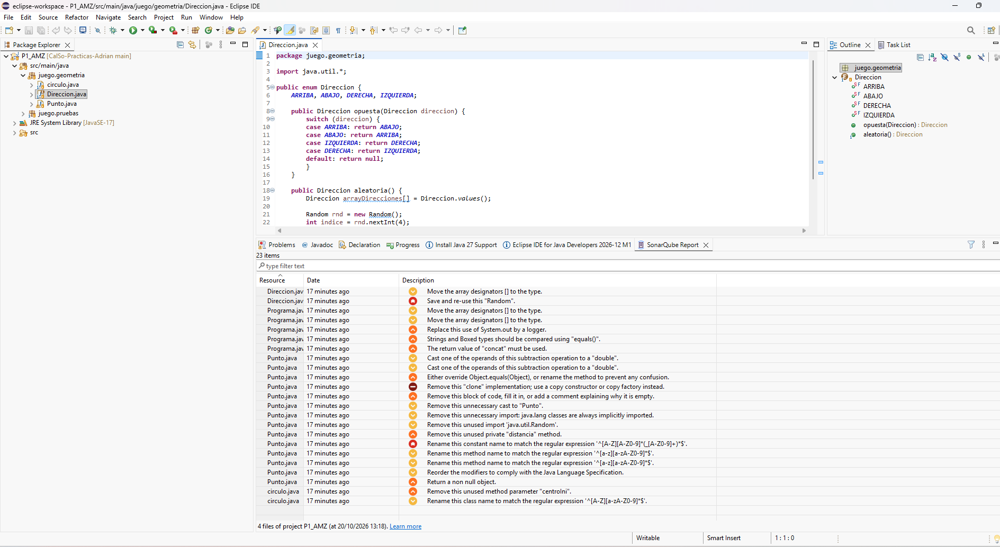
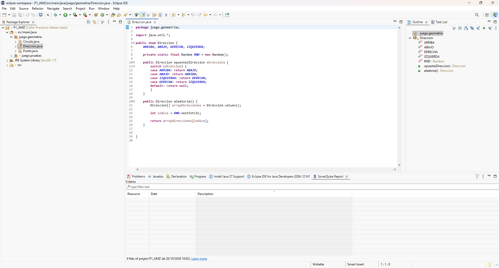

# Práctica 1 — Revisiones estáticas de código con SonarQube for Eclipse

## 1. Autor

| Miembro | Nombre y apellidos |
|---|---|
| Alumno | Adrián Martínez Zamora |

> Práctica realizada de forma individual.

**Nombre del proyecto Eclipse:** `P1_AMZ`

---

## 2. Análisis inicial

Antes de realizar ninguna modificación sobre el código proporcionado se ha ejecutado el análisis estático del proyecto completo utilizando **SonarQube for Eclipse** en modo standalone y con su configuración de reglas por defecto.

Antes del análisis se ha adaptado únicamente la configuración del proyecto Eclipse (sin tocar el código Java): se ha renombrado a `P1_AMZ`, se ha eliminado la naturaleza y el *builder* de Maven de `.project`, se ha sustituido el contenedor de Maven de `.classpath` por el JRE 17 y se ha fijado `bin/` como carpeta de salida, tal como exige el enunciado.

El análisis inicial detecta **23 disconformidades** en los 4 ficheros del proyecto.

### Captura inicial



---

## 3. Disconformidades detectadas

Las líneas se refieren al código original. El orden es el que muestra la vista *SonarQube Report*.

| Nº | Regla Sonar | Archivo | Línea | Disconformidad |
|---:|---|---|---:|---|
| 1 | `java:S1197` | `Direccion.java` | 19 | Move the array designators [] to the type. |
| 2 | `java:S2119` | `Direccion.java` | 21 | Save and re-use this "Random". |
| 3 | `java:S1197` | `Programa.java` | 7 | Move the array designators [] to the type. |
| 4 | `java:S1197` | `Programa.java` | 10 | Move the array designators [] to the type. |
| 5 | `java:S106` | `Programa.java` | 20 | Replace this use of System.out by a logger. |
| 6 | `java:S4973` | `Programa.java` | 18 | Strings and Boxed types should be compared using "equals()". |
| 7 | `java:S2201` | `Programa.java` | 16 | The return value of "concat" must be used. |
| 8 | `java:S2184` | `Punto.java` | 117 | Cast one of the operands of this subtraction operation to a "double". |
| 9 | `java:S2184` | `Punto.java` | 117 | Cast one of the operands of this subtraction operation to a "double". |
| 10 | `java:S1201` | `Punto.java` | 126 | Either override Object.equals(Object), or rename the method to prevent any confusion. |
| 11 | `java:S2975` | `Punto.java` | 136 | Remove this "clone" implementation; use a copy constructor or copy factory instead. |
| 12 | `java:S108` | `Punto.java` | 143 | Remove this block of code, fill it in, or add a comment explaining why it is empty. |
| 13 | `java:S1905` | `Punto.java` | 130 | Remove this unnecessary cast to "Punto". |
| 14 | `java:S1128` | `Punto.java` | 3 | Remove this unnecessary import: java.lang classes are always implicitly imported. |
| 15 | `java:S1128` | `Punto.java` | 4 | Remove this unused import 'java.util.Random'. |
| 16 | `java:S1144` | `Punto.java` | 116 | Remove this unused private "distancia" method. |
| 17 | `java:S115` | `Punto.java` | 11 | Rename this constant name to match the regular expression '^[A-Z][A-Z0-9]*(_[A-Z0-9]+)*$'. |
| 18 | `java:S100` | `Punto.java` | 51 | Rename this method name to match the regular expression '^[a-z][a-zA-Z0-9]*$'. (`Adyacente`) |
| 19 | `java:S100` | `Punto.java` | 82 | Rename this method name to match the regular expression '^[a-z][a-zA-Z0-9]*$'. (`situacion_relativa`) |
| 20 | `java:S1124` | `Punto.java` | 11 | Reorder the modifiers to comply with the Java Language Specification. |
| 21 | `java:S2225` | `Punto.java` | 145 | Return a non null object. |
| 22 | `java:S1172` | `circulo.java` | 10 | Remove this unused method parameter "centroIni". |
| 23 | `java:S101` | `circulo.java` | 3 | Rename this class name to match the regular expression '^[A-Z][a-zA-Z0-9]*$'. |

### Disconformidades aparecidas durante las correcciones

| Nº | Regla Sonar | Archivo | Línea | Disconformidad |
|---:|---|---|---:|---|
| 24 | `java:S1206` | `Punto.java` | 126 | This class overrides "equals()" and should therefore also override "hashCode()". |

> La nº 24 no aparece en el análisis inicial: surge al corregir la nº 10, cuando `equals` pasa a sobrescribir `Object.equals(Object)`.

---

## 4. Soluciones adoptadas

### Disconformidad 1 — `java:S1197`

**Localización:** `src/main/java/juego/geometria/Direccion.java`, línea 19  
**Responsable:** Adrián Martínez Zamora  
**Commit:** `pendiente`

**Problema detectado**

El array se declara con los corchetes junto al nombre de la variable (`Direccion arrayDirecciones[]`), estilo heredado de C que dificulta la lectura: el tipo de la variable es "array de `Direccion`" y así debe expresarse.

**Solución adoptada**

Se han movido los corchetes al tipo: `Direccion[] arrayDirecciones`.

---

### Disconformidad 2 — `java:S2119`

**Localización:** `src/main/java/juego/geometria/Direccion.java`, línea 21  
**Responsable:** Adrián Martínez Zamora  
**Commit:** `pendiente`

**Problema detectado**

Cada llamada a `aleatoria()` crea un objeto `Random` nuevo. Además de ser ineficiente, crear generadores sucesivos puede producir valores poco aleatorios (generadores inicializados con semillas muy próximas).

**Solución adoptada**

Se ha declarado un único generador como constante del enum (`private static final Random RND = new Random();`) y `aleatoria()` lo reutiliza.

---

### Disconformidad 3 — `java:S1197`

**Localización:** `src/main/java/juego/pruebas/Programa.java`, línea 7  
**Responsable:** Adrián Martínez Zamora  
**Commit:** `pendiente`

**Problema detectado**

El parámetro de `main` se declara como `String args[]`, con los corchetes junto al nombre.

**Solución adoptada**

Se ha cambiado a `String[] args`.

---

### Disconformidad 4 — `java:S1197`

**Localización:** `src/main/java/juego/pruebas/Programa.java`, línea 10  
**Responsable:** Adrián Martínez Zamora  
**Commit:** `pendiente`

**Problema detectado**

El array local se declara como `Punto puntos[]`, con los corchetes junto al nombre.

**Solución adoptada**

Se ha cambiado a `Punto[] puntos`.

---

### Disconformidad 5 — `java:S106`

**Localización:** `src/main/java/juego/pruebas/Programa.java`, línea 20  
**Responsable:** Adrián Martínez Zamora  
**Commit:** `pendiente`

**Problema detectado**

Se escribe directamente en la salida estándar con `System.out.println`. Sonar recomienda usar un *logger*, que permite configurar niveles, destino y formato de los mensajes.

**Solución adoptada**

Se ha añadido un `java.util.logging.Logger` como constante de la clase (`private static final Logger LOGGER = Logger.getLogger(Programa.class.getName());`) y el mensaje se emite con `LOGGER.info(mensaje)`.

---

### Disconformidad 6 — `java:S4973`

**Localización:** `src/main/java/juego/pruebas/Programa.java`, línea 18  
**Responsable:** Adrián Martínez Zamora  
**Commit:** `pendiente`

**Problema detectado**

Se comparan cadenas con `==` (`info == ""`). El operador `==` compara referencias, no contenido, por lo que el resultado depende de si las cadenas están internadas y no es fiable.

**Solución adoptada**

Se ha sustituido la comparación por `info.isEmpty()`, que comprueba el contenido de la cadena.

---

### Disconformidad 7 — `java:S2201`

**Localización:** `src/main/java/juego/pruebas/Programa.java`, línea 16  
**Responsable:** Adrián Martínez Zamora  
**Commit:** `pendiente`

**Problema detectado**

`String` es inmutable: `concat` devuelve una cadena nueva y no modifica `info`. Como el resultado se descarta, `info` sigue siempre vacía y el bucle no tiene efecto.

**Solución adoptada**

Se asigna el resultado: `info = info.concat(punto.toString());`.

---

### Disconformidades 8, 9 y 16 — `java:S2184` (×2) y `java:S1144`

**Localización:** `src/main/java/juego/geometria/Punto.java`, líneas 113-118 (método `distancia`)  
**Responsable:** Adrián Martínez Zamora  
**Commit:** `pendiente`

**Problema detectado**

- S1144: el método privado `distancia` no se invoca en ninguna parte; es código muerto.
- S2184 (×2): dentro de ese método, las restas `this.x-posicion.x` y `this.y-posicion.y` se calculan en aritmética entera antes de convertirse a `double`, con riesgo de desbordamiento.

**Solución adoptada**

Se ha eliminado el método `distancia` junto con su comentario. Al tratarse de código muerto identificado por la propia regla S1144, su eliminación es una corrección válida; y como las dos disconformidades S2184 están dentro de ese método, desaparecen con la misma modificación atómica, por lo que se resuelven en un único commit.

---

### Disconformidad 10 — `java:S1201`

**Localización:** `src/main/java/juego/geometria/Punto.java`, línea 126  
**Responsable:** Adrián Martínez Zamora  
**Commit:** `pendiente`

**Problema detectado**

El método `equals(Punto)` **sobrecarga** `Object.equals(Object)` en lugar de sobrescribirlo. Las colecciones (`HashSet`, `List.contains`, etc.) y cualquier código que trabaje con `Object` invocan `equals(Object)`, que sigue comparando referencias, por lo que dos puntos con las mismas coordenadas no se consideran iguales.

**Solución adoptada**

Se ha cambiado la firma a `public boolean equals(Object obj)` con `@Override`, comprobando el tipo con `instanceof` (que además devuelve `false` si `obj` es `null`):

```java
@Override
public boolean equals(Object obj) {
    if (this == obj)
        return true;
    if (!(obj instanceof Punto other))
        return false;

    return (x == other.x && y == other.y);
}
```

---

### Disconformidades 11, 12 y 21 — `java:S2975`, `java:S108` y `java:S2225`

**Localización:** `src/main/java/juego/geometria/Punto.java`, líneas 135-146 (método `clone`)  
**Responsable:** Adrián Martínez Zamora  
**Commit:** `pendiente`

**Problema detectado**

- S2975: se sobrescribe `clone()`, mecanismo desaconsejado. Además `Punto` no implementa `Cloneable`, por lo que `super.clone()` lanza siempre `CloneNotSupportedException`.
- S108: esa excepción se captura en un bloque `catch` vacío, ocultando el error.
- S2225: en consecuencia, `clone()` devuelve siempre `null`.

**Solución adoptada**

Se ha eliminado el método `clone()`, como indica la regla S2975. La clase ya dispone de un constructor de copia, `Punto(Punto otra)`, que es la alternativa recomendada; ninguna parte del proyecto invocaba `clone()`. Las tres disconformidades están en el mismo método y desaparecen con la misma modificación, por lo que se resuelven en un único commit.

---

### Disconformidad 13 — `java:S1905`

**Localización:** `src/main/java/juego/geometria/Punto.java`, línea 130  
**Responsable:** Adrián Martínez Zamora  
**Commit:** `pendiente`

**Problema detectado**

En `equals(Punto obj)` se hace `(Punto) obj`, pero `obj` ya es de tipo `Punto`: el cast no aporta nada.

**Solución adoptada**

Se ha eliminado la variable auxiliar con el cast y se usan directamente los campos de `obj`: `return (x == obj.x && y == obj.y);`.

---

### Disconformidad 14 — `java:S1128`

**Localización:** `src/main/java/juego/geometria/Punto.java`, línea 3  
**Responsable:** Adrián Martínez Zamora  
**Commit:** `pendiente`

**Problema detectado**

Se importa `java.lang.Math`, pero las clases de `java.lang` se importan implícitamente.

**Solución adoptada**

Se ha eliminado `import java.lang.Math;`.

---

### Disconformidad 15 — `java:S1128`

**Localización:** `src/main/java/juego/geometria/Punto.java`, línea 4  
**Responsable:** Adrián Martínez Zamora  
**Commit:** `pendiente`

**Problema detectado**

Se importa `java.util.Random`, que no se utiliza en la clase.

**Solución adoptada**

Se ha eliminado `import java.util.Random;`.

---

### Disconformidad 17 — `java:S115`

**Localización:** `src/main/java/juego/geometria/Punto.java`, línea 11  
**Responsable:** Adrián Martínez Zamora  
**Commit:** `pendiente`

**Problema detectado**

La constante `defaultValue` no sigue la convención de nombres de constantes (mayúsculas separadas por guiones bajos).

**Solución adoptada**

Se ha renombrado a `DEFAULT_VALUE` mediante *Refactor > Rename*.

---

### Disconformidad 18 — `java:S100`

**Localización:** `src/main/java/juego/geometria/Punto.java`, línea 51  
**Responsable:** Adrián Martínez Zamora  
**Commit:** `pendiente`

**Problema detectado**

El método `Adyacente` empieza por mayúscula, incumpliendo la convención de nombres de métodos (*lowerCamelCase*).

**Solución adoptada**

Se ha renombrado a `adyacente` mediante *Refactor > Rename*, que actualiza también la llamada desde `isAdyacente`.

---

### Disconformidad 19 — `java:S100`

**Localización:** `src/main/java/juego/geometria/Punto.java`, línea 82  
**Responsable:** Adrián Martínez Zamora  
**Commit:** `pendiente`

**Problema detectado**

El método `situacion_relativa` usa guion bajo, incumpliendo la convención *lowerCamelCase*.

**Solución adoptada**

Se ha renombrado a `situacionRelativa` mediante *Refactor > Rename*.

---

### Disconformidad 20 — `java:S1124`

**Localización:** `src/main/java/juego/geometria/Punto.java`, línea 11  
**Responsable:** Adrián Martínez Zamora  
**Commit:** `pendiente`

**Problema detectado**

Los modificadores aparecen como `final static`, en lugar del orden recomendado por la especificación del lenguaje.

**Solución adoptada**

Se han reordenado a `public static final`.

---

### Disconformidad 22 — `java:S1172`

**Localización:** `src/main/java/juego/geometria/circulo.java`, línea 10  
**Responsable:** Adrián Martínez Zamora  
**Commit:** `pendiente`

**Problema detectado**

El constructor recibe `centroIni` pero no lo utiliza, de modo que el campo `centro` queda a `null` y `getCentro()` o `desplazar()` provocarían una `NullPointerException`.

**Solución adoptada**

En lugar de eliminar el parámetro (que forma parte del funcionamiento esperado del constructor) se ha usado para inicializar el campo, con una copia defensiva: `centro = new Punto(centroIni);`.

---

### Disconformidad 23 — `java:S101`

**Localización:** `src/main/java/juego/geometria/circulo.java`, línea 3  
**Responsable:** Adrián Martínez Zamora  
**Commit:** `pendiente`

**Problema detectado**

El nombre de la clase `circulo` empieza por minúscula, incumpliendo la convención *UpperCamelCase*.

**Solución adoptada**

Se ha renombrado la clase a `Circulo` mediante *Refactor > Rename*, lo que renombra también el fichero a `Circulo.java` y sus constructores.

---

### Disconformidad 24 — `java:S1206`

**Localización:** `src/main/java/juego/geometria/Punto.java`, método `equals`  
**Responsable:** Adrián Martínez Zamora  
**Commit:** `pendiente`

**Problema detectado**

Tras corregir la nº 10, la clase sobrescribe `equals(Object)` pero no `hashCode()`. Esto rompe el contrato de `Object`: dos puntos iguales podrían tener distinto *hash* y comportarse de forma incorrecta en `HashMap` o `HashSet`.

**Solución adoptada**

Se ha añadido `hashCode()` coherente con `equals`, basado en las mismas coordenadas:

```java
@Override
public int hashCode() {
    return Objects.hash(x, y);
}
```

---

## 5. Resumen de las correcciones

| Nº | Regla Sonar | Responsable | Commit | Resultado |
|---:|---|---|---|---|
| 1 | `java:S1197` | Adrián Martínez Zamora | `pendiente` | Pendiente |
| 2 | `java:S2119` | Adrián Martínez Zamora | `pendiente` | Pendiente |
| 3 | `java:S1197` | Adrián Martínez Zamora | `pendiente` | Pendiente |
| 4 | `java:S1197` | Adrián Martínez Zamora | `pendiente` | Pendiente |
| 5 | `java:S106` | Adrián Martínez Zamora | `pendiente` | Pendiente |
| 6 | `java:S4973` | Adrián Martínez Zamora | `pendiente` | Pendiente |
| 7 | `java:S2201` | Adrián Martínez Zamora | `pendiente` | Pendiente |
| 8 | `java:S2184` | Adrián Martínez Zamora | `pendiente` (mismo que 16) | Pendiente |
| 9 | `java:S2184` | Adrián Martínez Zamora | `pendiente` (mismo que 16) | Pendiente |
| 10 | `java:S1201` | Adrián Martínez Zamora | `pendiente` | Pendiente |
| 11 | `java:S2975` | Adrián Martínez Zamora | `pendiente` | Pendiente |
| 12 | `java:S108` | Adrián Martínez Zamora | `pendiente` (mismo que 11) | Pendiente |
| 13 | `java:S1905` | Adrián Martínez Zamora | `pendiente` | Pendiente |
| 14 | `java:S1128` | Adrián Martínez Zamora | `pendiente` | Pendiente |
| 15 | `java:S1128` | Adrián Martínez Zamora | `pendiente` | Pendiente |
| 16 | `java:S1144` | Adrián Martínez Zamora | `pendiente` | Pendiente |
| 17 | `java:S115` | Adrián Martínez Zamora | `pendiente` | Pendiente |
| 18 | `java:S100` | Adrián Martínez Zamora | `pendiente` | Pendiente |
| 19 | `java:S100` | Adrián Martínez Zamora | `pendiente` | Pendiente |
| 20 | `java:S1124` | Adrián Martínez Zamora | `pendiente` | Pendiente |
| 21 | `java:S2225` | Adrián Martínez Zamora | `pendiente` (mismo que 11) | Pendiente |
| 22 | `java:S1172` | Adrián Martínez Zamora | `pendiente` | Pendiente |
| 23 | `java:S101` | Adrián Martínez Zamora | `pendiente` | Pendiente |
| 24 | `java:S1206` | Adrián Martínez Zamora | `pendiente` | Pendiente |

---

## 6. Análisis final

Una vez realizadas todas las modificaciones se ha vuelto a ejecutar el análisis del proyecto completo con **SonarQube for Eclipse**.

### Captura final



La captura final permite comprobar que se está analizando el mismo proyecto utilizado en la captura inicial y que ya no quedan disconformidades pendientes.

### Observaciones

Que Sonar no muestre disconformidades no garantiza que el programa sea correcto. Durante la revisión se han observado defectos funcionales que las reglas aplicadas no detectan y que no se han modificado por quedar fuera del alcance de la práctica:

- `Programa.main` lanza una `NullPointerException`: el array `puntos` tiene dos posiciones y solo se inicializa la primera, de modo que `punto.toString()` se invoca sobre `null` en la segunda iteración. Este fallo ya existía en el código original.
- `Punto.situacionRelativa` calcula las diferencias con `Math.abs`, por lo que las condiciones de `ARRIBA`/`ABAJO` y de `IZQUIERDA`/`DERECHA` son idénticas y el método nunca puede devolver `ABAJO` ni `DERECHA`.

---

## 7. Proyecto final

La versión final del proyecto Eclipse se encuentra en:

```text
P1/proyecto/P1_AMZ/
```

El proyecto incluido en esta carpeta contiene las modificaciones correspondientes a las soluciones documentadas anteriormente y coincide con la versión sobre la que se ha realizado la captura final.

---

## 8. Comprobación de la entrega

- [x] El nombre del proyecto sigue el formato establecido: `P1_AMZ`.
- [x] Se identifica al autor de la práctica.
- [x] Se incluye la captura del análisis inicial.
- [x] Se han documentado todas las disconformidades inicialmente detectadas.
- [ ] Cada solución está asociada a un commit identificable en `main`.
- [x] Se identifica el responsable de cada corrección.
- [ ] Se incluye la captura del análisis final.
- [ ] La captura final permite comprobar que no quedan disconformidades.
- [x] Se ha incorporado el proyecto Eclipse final dentro de `P1/proyecto/`.
- [ ] El proyecto final corresponde al código analizado en la captura final.
