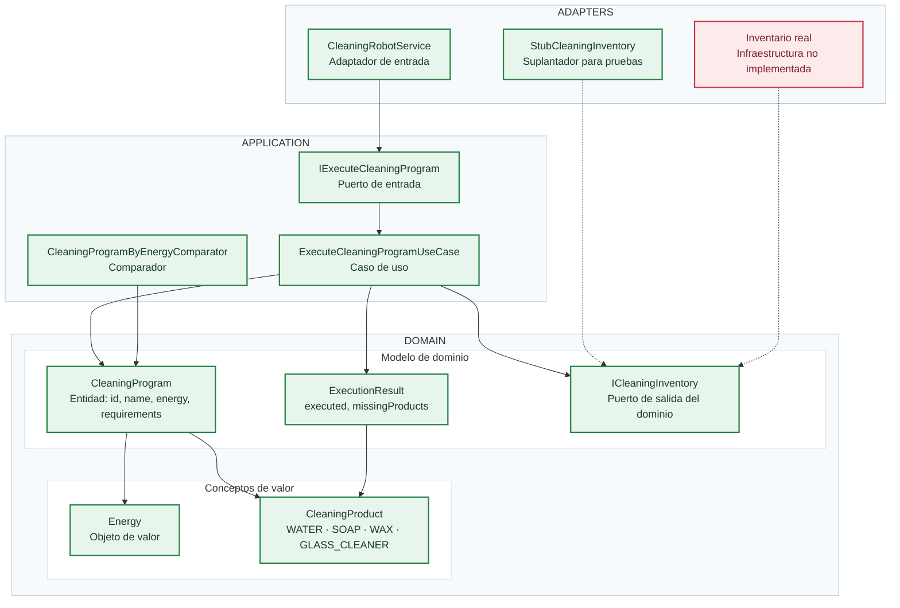
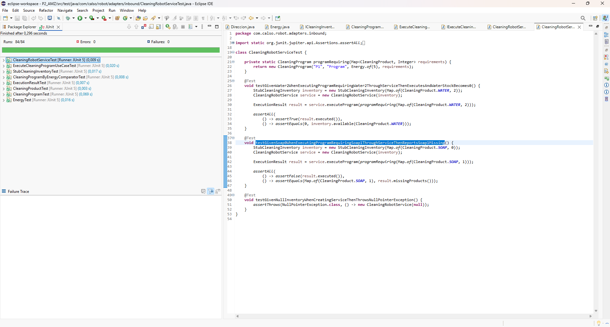
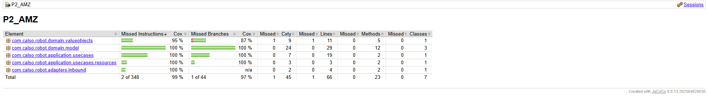
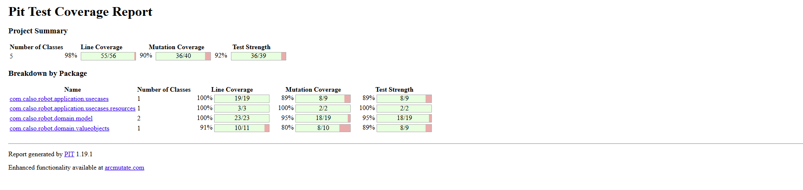
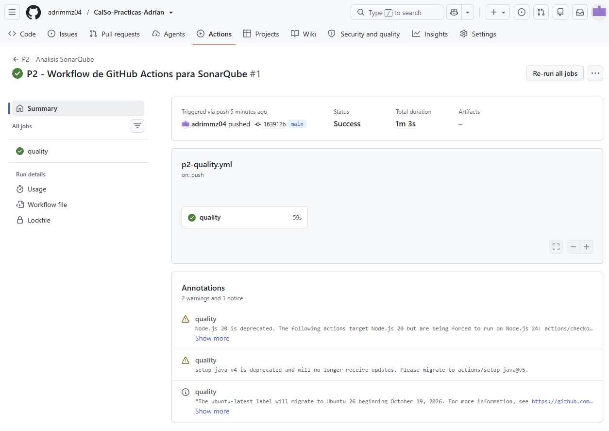
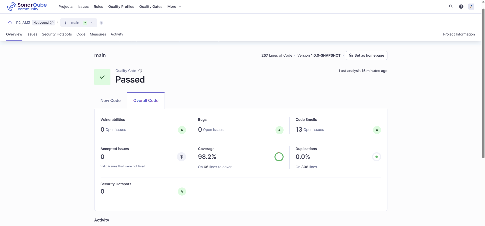

# Práctica 2. Pruebas unitarias y análisis de calidad

**Calidad del Software · Curso 2026-2027**

## Descripción del caso práctico

Una empresa está desarrollando el software de un robot que ejecuta distintos programas de limpieza. Cada programa requiere una cantidad fija de energía y puede necesitar agua, jabón, cera o limpiacristales. El robot consulta las existencias antes de empezar: si falta algún producto, informa de las unidades necesarias y no consume nada; si hay suficiente de todos, realiza los descuentos. En esta práctica la energía identifica el consumo del programa, pero no se gestiona una batería.

Recibiréis un proyecto Java que compila y contiene defectos de comportamiento. Vuestro trabajo consiste en **descubrirlos mediante pruebas JUnit 5 diseñadas a partir de la especificación**, corregirlos y analizar los resultados de calidad obtenidos al terminar. No se facilita la cantidad ni la ubicación de los defectos.

Trabajaréis principalmente en **Eclipse**. El proyecto utiliza Maven y una organización basada en dominio, aplicación y adaptadores. La especificación que determina el comportamiento correcto está en `docs/specification.md`. **El código entregado no es la especificación**: precisamente puede contener errores.

### Bounded context y alcance del slice

El siguiente diagrama presenta los conceptos principales de **Robot Cleaning**, sus relaciones y su distribución entre las capas **Adapters**, **Application** y **Domain**. Permite distinguir el código comprendido en el slice de esta práctica de la funcionalidad que queda fuera de su desarrollo.



**Cómo interpretarlo:** los elementos **verdes** pertenecen al slice y los **rojos** están fuera de su alcance o no se implementan en esta práctica. La interfaz `ICleaningInventory` está situada en la **capa de dominio**, aunque sea utilizada por el caso de uso de aplicación. El inventario real no se implementa: en las pruebas del caso de uso se desarrolla `StubCleaningInventory` dentro de `src/test/java`, para controlar las existencias sin depender de infraestructura real.

El diagrama es una visión arquitectónica, no sustituye la [especificación de comportamiento](docs/specification.md), que es la referencia para diseñar los casos de prueba.

## Estructura del repositorio de GitHub

Cada grupo dispone de un único repositorio para todas las prácticas. Dentro de él se encuentra el proyecto Maven de la segunda práctica:

```text
Repositorio-del-grupo/
├── .github/
│   └── workflows/
│       └── p2-quality.yml
├── P1/
└── P2/
    ├── README_P2.md
    ├── docs/
    └── P2_INICIALES/ (Cambiar las iniciales por las que correspondan)
        ├── pom.xml
        └── src/
```

Para conectar las acciones de GitHub con la herramienta externa configuraremos un flujo de trabajo. El workflow se guardará en **`.github/workflows/` de la raíz del repositorio**, no dentro de la carpeta `P2/` ni del proyecto Java. La ruta exacta al proyecto Maven será `P2/P2_INICIALES/`.

LA estructura del archivo `.yml` será la siguiente, modificando las rutas pertinentes:

```yml
name: P2 - Analisis SonarQube
on:
  push:
    branches: [main]
    paths:
      - 'P2/P2_INICIALES/**'
      - '.github/workflows/p2-quality.yml'
  workflow_dispatch:

permissions:
  contents: read

jobs:
  quality:
    runs-on: ubuntu-latest
    defaults:
      run:
        working-directory: P2/P"_INICIALES
    steps:
      - name: Checkout
        uses: actions/checkout@v4
        with:
          fetch-depth: 0
      - name: Configurar Java
        uses: actions/setup-java@v4
        with:
          distribution: temurin
          java-version: '21'
          cache: maven
          cache-dependency-path: P2/P2_INICIALES/pom.xml
      - name: Pruebas JUnit e informe JaCoCo
        run: mvn -B clean verify
      - name: Comprobar configuracion
        env:
          SONAR_TOKEN: ${{ secrets.SONAR_TOKEN }}
          SONAR_HOST_URL: ${{ vars.SONAR_HOST_URL }}
          SONAR_PROJECT_KEY: ${{ vars.SONAR_PROJECT_KEY }}
        run: |
          test -n "$SONAR_TOKEN" || { echo 'Falta SONAR_TOKEN'; exit 1; }
          test -n "$SONAR_HOST_URL" || { echo 'Falta SONAR_HOST_URL'; exit 1; }
          test -n "$SONAR_PROJECT_KEY" || { echo 'Falta SONAR_PROJECT_KEY'; exit 1; }
      - name: Publicar analisis en SonarQube
        env:
          SONAR_TOKEN: ${{ secrets.SONAR_TOKEN }}
          SONAR_HOST_URL: ${{ vars.SONAR_HOST_URL }}
          SONAR_PROJECT_KEY: ${{ vars.SONAR_PROJECT_KEY }}
        run: >
          mvn -B org.sonarsource.scanner.maven:sonar-maven-plugin:5.1.0.4751:sonar
          -Dsonar.projectKey="$SONAR_PROJECT_KEY"
          -Dsonar.host.url="$SONAR_HOST_URL"
          -Dsonar.token="$SONAR_TOKEN"
          -Dsonar.coverage.jacoco.xmlReportPaths=target/site/jacoco/jacoco.xml
```

En grupos de dos, uno de los integrantes puede configurar los permisos y secretos, siempre que disponga de autorización en GitHub. No hace falta que ambos creen tokens ni duplicar la configuración.

## 1. Preparación y pruebas en Eclipse

Importad `robot-cleaning/` mediante **File → Import → Maven → Existing Maven Projects**. Comprobad que Eclipse reconoce las fuentes de producción y las de pruebas. Leed primero la especificación y diseñad casos con datos normales, valores límite, situaciones inválidas y comportamientos de igualdad u ordenación, según corresponda.

Consultad también la documentación oficial de **JUnit 5**, especialmente Jupiter, las aserciones y la ejecución de pruebas: [JUnit 5 User Guide](https://junit.org/junit5/docs/current/user-guide/). No es necesario reproducir el manual en el informe, pero sí aplicar correctamente las herramientas del framework.

Como guía rápida para la creación de pruebas con jUnit 5 puedes consultar el documento: [Crear y ejecutar test](docs/Crear_y_ejecutar_tests.md). Además, se puede consultar la guía rápida de jUnit del curso pasado: [Guía jUnit del curso 2026](https://github.com/marcialpamies/P2-CalSo/blob/main/docs/manual_JUnit5.md).

### Localización de las pruebas asociadas a una clase concreta

Las clases de jUnit 5 que contengan los casos de prueba de una clase concreta `ClaseDePrueba.java`, localizada en el paquete `paquete.de.clase` de la carpeta `src` deberán localizarse en el mismo paquete `paquete.de.clase` pero en la carpeta `test` y se nombrarán siguiendo el convenio `testClaseDePrueba.java`. 

Por ejemplo, las pruebas de la clase siguiente que se encuentran en la carpeta del proyecto `src/main/java` en el paquete `com.calso.robot.domain.valueobjects`

```java
package com.calso.robot.domain.valueobjects;

public final class Energy {
...
}
```
Deben localizarse en la clase jUnit 5 siguiente, que se localizará en la carpeta `src/test/java` y en el mismo paquete `com.calso.robot.domain.valueobjects`:

```java
package com.calso.robot.domain.valueobjects;

import org.junit.jupiter.api.Test;
import static org.junit.jupiter.api.Assertions.*;

class EnergyTest {
...
}
```
De esta forma las pruebas quedan alineadas con la estructura de la arquitectura seleccionada.


### Consulta rápida de JUnit 5

Una prueba escrita con Jupiter suele utilizar `@Test`. Cada método prepara sus datos, ejecuta una operación y comprueba el resultado esperado. Por ejemplo:

```java
import static org.junit.jupiter.api.Assertions.assertEquals;
import static org.junit.jupiter.api.Assertions.assertThrows;

import org.junit.jupiter.api.Test;

class EnergyTest {

    @Test
    void testGivenEnergy10WhenCreatingEnergyThenStoresValue10() {
        Energy energy = Energy.of(10);
        assertEquals(10, energy.value());
    }

    @Test
    void testGivenEnergyMinus1WhenCreatingEnergyThenThrowsIllegalArgumentException() {
        assertThrows(IllegalArgumentException.class,
                () -> Energy.of(-1));
    }

    @Test
    void testGivenTwoEnergyValues10WhenComparingThenTheyAreEqual() {
        Energy first = Energy.of(10);
        Energy second = Energy.of(10);
        assertEquals(first, second);
    }
}
```

### Convención obligatoria y precisión de los nombres de las pruebas

Todos los métodos JUnit 5, incluidos los parametrizados, tendrán nombres en **inglés**, en formato **camelCase**, con esta estructura:

```text
testGiven<Condición>When<Acción>Then<ResultadoEsperado>
```

Las partes `testGiven`, `When` y `Then` son obligatorias; cada una irá seguida de una descripción que comience por mayúscula. `And` es opcional y permite añadir condiciones o resultados relacionados.

**El nombre debe identificar el escenario concreto**, no solo la regla general que se está comprobando. Incluid los valores y condiciones que permiten distinguir el caso de otros similares, especialmente límites, existencias, cantidades requeridas y diferencias entre objetos. No es necesario reflejar todos los datos auxiliares. El nombre debe corresponderse con las entradas y las aserciones reales.

Por ejemplo, es demasiado genérico `testGivenInsufficientStockWhenExecutingProgramThenReportsMissingProducts`. Un nombre más preciso sería:

```java
@Test
void testGivenWater2AndSoap0WhenExecutingProgramRequiringWater2AndSoap1ThenReportsSoap1MissingAndPreservesStock() {
    // ...
}
```

Otros escenarios específicos:

```java
@Test
void testGivenEnergy0WhenCreatingEnergyThenThrowsIllegalArgumentException() {
    // ...
}

@Test
void testGivenWater2WhenExecutingProgramRequiringWater2ThenWaterStockBecomes0() {
    // ...
}
```

Los nombres `testExecuteProgram()`, `givenStockWhenExecutingThenSucceeds()` y `testGivenStockWhenExecuting()` incumplen la estructura. Un nombre que respeta esa estructura también puede ser insuficiente si no distingue el caso concreto.

**Control en SonarQube.** El Quality Profile Java **CalSo - Java Docencia** incorpora la regla `java:S3578`, que comprueba la estructura de nombres. Su incumplimiento genera incidencias y **hace fallar el Quality Gate configurado para las prácticas CalSo**. El profesorado comprobará además la correspondencia entre el nombre, los datos y las aserciones. Usad nombres precisos desde la primera prueba.

El fallo del Quality Gate no significa necesariamente que la Action de GitHub falle: son controles distintos.

Estos ejemplos son orientativos: debéis comprobar las firmas y los contratos reales del proyecto. En particular, los métodos y resultados esperados de cada prueba deben deducirse de la especificación.

| Aserción | Uso |
| --- | --- |
| `assertEquals(expected, actual)` | Comprueba igualdad |
| `assertNotEquals(unexpected, actual)` | Comprueba desigualdad |
| `assertTrue(condition)` / `assertFalse(condition)` | Comprueba una condición |
| `assertNull(value)` / `assertNotNull(value)` | Comprueba valores nulos |
| `assertThrows(Type.class, executable)` | Comprueba una excepción |
| `assertDoesNotThrow(executable)` | Comprueba que no se lanza una excepción |
| `assertAll(...)` | Agrupa comprobaciones relacionadas |

Si el contrato especifica un mensaje de excepción, comprobadlo también. Usad `@BeforeEach` únicamente para una preparación común, independiente y sencilla. No compartáis estado mutable entre pruebas.

Para comparar colecciones, elegid una aserción acorde con el contrato: `assertIterableEquals` cuando el orden sea relevante, `assertEquals` cuando la colección proporcione la igualdad necesaria o una comprobación específica cuando únicamente importe la pertenencia.

Escribid pruebas JUnit 5 para `Energy`, `CleaningProduct`, `CleaningProgram` y `CleaningProgramByEnergyComparator`. Sus nombres deben describir la condición y el resultado esperado, por ejemplo `testGivenDifferentEnergiesWhenComparingProgramsThenSortsAscending`. Las pruebas serán **deterministas, independientes y lo más atómicas posible**: no deberán depender del orden de ejecución ni de datos creados por otra prueba. Evitad reunir comprobaciones no relacionadas en un mismo método, pues esto dificulta localizar los fallos.

Ejecutad las pruebas con **Run As → JUnit Test** desde Eclipse o con `mvn test`. Para la verificación completa podéis utilizar `mvn clean verify`. Cuando una prueba falle, comprobad primero que refleja la especificación. Si es correcta, localizad el defecto, corregidlo y ejecutadla de nuevo. Conservad cada prueba útil en la batería final.

No se valora crear muchas pruebas parecidas, sino comprobar comportamientos diferentes y justificar las elecciones.

## 2. Probar la aplicación cuando falta una dependencia

El inventario real todavía no está desarrollado. El caso de uso `ExecuteCleaningProgramUseCase` conoce únicamente la interfaz `ICleaningInventory`, de modo que puede probarse sin esperar a que exista ese módulo.

Implementad **vosotros mismos** `StubCleaningInventory` a partir del esqueleto incluido en `src/test/java/com/calso/robot/application/usecases/`. Debe aceptar unas existencias iniciales, devolver cero para productos que no estén registrados y descontar cantidades válidas sin dejar valores negativos. Los intentos de descontar cantidades negativas o superiores a las disponibles deben producir la excepción indicada en el contrato sin alterar el inventario. Cada instancia debe conservar su propio estado.

Usad ese suplantador para diseñar pruebas del caso de uso: ejecución permitida, existencias exactas, falta de uno o varios productos, ausencia de cambios si la ejecución se rechaza y programas que no requieren productos. Verificad tanto el resultado devuelto como las existencias finales. El suplantador **forma parte del código de pruebas**, no de producción. No se piden contadores de llamadas ni comprobaciones de interacciones internas.

En el informe explicad brevemente qué dependencia estáis sustituyendo, por qué el uso de una interfaz lo permite y cómo ayuda a probar una parte del sistema antes de completar el resto.

## 3. Trabajo individual, integración y análisis

La asignatura utiliza **un repositorio por grupo**, con una carpeta para cada práctica. Incorporad esta actividad dentro de `P2/`, manteniendo `README_P2.md`, el proyecto Maven y la carpeta `evidencias/`.

**Parejas.** Cada integrante crea desde `main` una rama propia y se responsabiliza de una parte del proyecto. Se propone repartir *dominio y comparador* frente a *suplantador y caso de uso*; podéis acordar otro reparto de carga semejante y dejarlo escrito antes de empezar. Desarrollad y realizad commits en vuestra rama hasta completar el bloque. A continuación, abrid una **Pull Request** hacia `main`. El compañero revisará los cambios y, después, integraréis ambas ramas.

Conservad un historial que permita reconocer la autoría y evolución de cada aportación. Utilizad commits pequeños y coherentes, con mensajes descriptivos, realizados por quien implementa cada cambio. Por ejemplo, separad los commits de pruebas, correcciones y documentación. En la Pull Request, describid los cambios, enlazad las pruebas relevantes y revisad el código del compañero antes de aprobarla. Si hay conflictos, resolvedlos conjuntamente y comprobad después que la suite completa sigue pasando. No trabajéis los dos directamente sobre la misma rama ni compartáis credenciales. Los resultados finales deben corresponder a la versión integrada en `main`.

**Grupos individuales.** Realizad todos los cambios y commits directamente en `main`; no se exigen ramas ni Pull Requests. Mantened commits descriptivos que permitan relacionar las pruebas con los defectos detectados y sus correcciones.

Al finalizar, ejecutad la suite completa desde Eclipse y generad los análisis desde **Run As → Maven build…**:

| Análisis | Objetivo de Maven | Dónde consultar el resultado |
| --- | --- | --- |
| Pruebas y JaCoCo | `clean verify` | Vista JUnit de Eclipse y `target/site/jacoco/index.html` |
| PIT | `org.pitest:pitest-maven:mutationCoverage` | Informe HTML dentro de `target/pit-reports/` |
| SonarQube | Action preparada en GitHub, rama `main` | Proyecto del grupo en https://sast.inf.um.es/ |

### Guías de apoyo y configuración

Las explicaciones breves de este enunciado se complementan con los siguientes documentos. Consultadlos cuando necesitéis interpretar un informe o configurar las herramientas; no es necesario reproducir sus definiciones en el vídeo.

| Guía | Contenido |
| --- | --- |
| [Introducción a JaCoCo](docs/JACOCO.md) | Cobertura, informe HTML y selección de evidencias |
| [Introducción a PIT](docs/PIT.md) | Mutantes, resultados y posibles pruebas |
| [Introducción a SonarQube](docs/SONARQUBE.md) | Reglas, incidencias y Quality Gate |
| [Configuración de GitHub Actions](docs/SONAR_GITHUB.md) | Proyecto, token, variables y publicación del análisis |
| [Eclipse y SonarQube](docs/ECLIPSE_SONAR.md) | Instalación opcional del complemento y modo conectado |

JaCoCo y PIT funcionan mediante Maven con la configuración del proyecto. La conexión de SonarQube con Eclipse es **opcional**; el análisis que se evaluará es el publicado desde GitHub Actions sobre `main`.

### Consulta rápida de JaCoCo

JaCoCo es una herramienta de cobertura de código. Indica qué partes de la implementación han sido ejecutadas por las pruebas, pero no demuestra que las pruebas sean correctas ni que hayan detectado todos los defectos.

El informe HTML se genera en `target/site/jacoco/index.html`. Conviene distinguir:

- **Instruction coverage**: instrucciones de bytecode ejecutadas.
- **Branch coverage**: ramas de decisión ejecutadas.
- **Line coverage**: líneas ejecutadas.
- **Method coverage**: métodos invocados.
- **Class coverage**: clases utilizadas.

En esta práctica registraréis principalmente instrucciones y ramas. La cobertura de ramas aporta información sobre decisiones alternativas, pero no garantiza que se hayan comprobado los valores límite ni los resultados esperados. Desde el informe podéis navegar hasta cada clase y observar el código ejecutado total o parcialmente. No incorporéis `target/` al repositorio.

### Consulta rápida de PIT

PIT realiza análisis de mutación. Introduce pequeños cambios temporales en el código y ejecuta las pruebas para comprobar si los detectan.

- **Killed mutants**: mutantes detectados por las pruebas.
- **Survived mutants**: mutantes que no provocaron fallos.
- **No coverage**: mutantes en código que no han alcanzado las pruebas.
- **Mutation coverage**: proporción de mutantes eliminados respecto al total considerado.
- **Test strength**: proporción de mutantes eliminados entre los que tenían cobertura.

Un mutante superviviente no demuestra necesariamente que el programa original contenga un error: puede ser equivalente o señalar un comportamiento que las pruebas no comprueban. Revisad tanto el resumen como el detalle por clase y método. El informe HTML se encuentra dentro de `target/pit-reports/`. No alteréis los resultados para ocultar mutantes.

### SonarQube

Para configurar SonarQube, seguid `docs/SONAR_GITHUB.md`. El profesorado facilitará el identificador del proyecto y cómo registrar el token como secreto. **No incluyáis credenciales en el repositorio**. Consultad el análisis de `main`, el estado del Quality Gate y las incidencias encontradas.

### Vídeo de análisis de calidad del software

El grupo elaborará un vídeo de **7 minutos como máximo**, incluida la presentación inicial, en el que analizará resultados concretos obtenidos con JaCoCo, SonarQube y PIT sobre la versión final del proyecto.

El vídeo comenzará con una presentación de los participantes, mostrando su imagen en directo durante un máximo de 30 segundos. A continuación, se grabará la pantalla mientras se navega por los informes y el código.

El análisis deberá incluir:

- **JaCoCo:** seleccionar un resultado concreto de cobertura, identificar el código o las ramas afectadas, explicar su significado y proponer una prueba que permita mejorar la comprobación de ese comportamiento.
- **SonarQube:** seleccionar una incidencia concreta, identificar la regla aplicada y el código afectado, explicar el problema y plantear una posible solución. También se mostrará el estado general del Quality Gate.
- **PIT:** seleccionar un mutante superviviente, mostrar el cambio introducido, explicar por qué las pruebas no lo detectan y proponer una actuación para resolver esa situación.

Si no existen incidencias o mutantes supervivientes, podrá seleccionarse un resultado alternativo que permita realizar un análisis técnico equivalente.

No se trata de describir las herramientas ni de leer sus métricas. El objetivo es **interpretar evidencias del propio proyecto, relacionarlas con el código desarrollado y razonar posibles vías de actuación**. No será necesario implementar las mejoras propuestas.

Finalizad el vídeo indicando qué actuación consideraríais prioritaria y justificad vuestra elección. En grupos de dos, ambos estudiantes deberán intervenir de forma equilibrada y explicar resultados concretos.

#### Requisitos de grabación y calidad

El vídeo podrá realizarse en español o en inglés y deberá cumplir estas condiciones:

- La imagen debe permitir leer claramente el código y los informes.
- La voz debe escucharse con claridad, con volumen adecuado y sin ruidos que dificulten la comprensión.
- Deben mostrarse las acciones realizadas, el movimiento del ratón y la navegación real por las herramientas.
- La explicación debe realizarse al mismo tiempo que se muestran las acciones; no se sustituirá por una voz en off añadida posteriormente.
- Debe mantenerse la continuidad entre las acciones y la explicación.
- El vídeo debe reproducirse correctamente desde el enlace entregado.

No se evalúa la edición del vídeo, pero sí su legibilidad, el sonido, la duración y la posibilidad de comprobar las explicaciones técnicas.

#### Publicación y entrega del vídeo

Alojad el vídeo en una plataforma externa, como **YouTube, con visibilidad «Oculto/No listado»**, accesible mediante un enlace directo sin solicitar permisos adicionales. No es necesario hacerlo público.

Incluid el enlace de reproducción en este `README_P2.md` y comprobad que funciona desde otra sesión o navegador. El profesorado podrá realizar una entrevista individual breve si necesita verificar la comprensión de los resultados presentados.

## 4. Qué debéis entregar

La entrega es el contenido de `P2/` en el repositorio del grupo, incluido el proyecto Maven con sus tests, el suplantador implementado y las correcciones. Utilizad **`README_P2.md` como informe**: completad la sección final conservando estas instrucciones.

| Evidencia | Información que debe poder comprobarse |
| --- | --- |
| Integrantes y reparto | Nombre y apellidos, responsabilidades y, en parejas, enlaces a las ramas y Pull Requests |
| Casos de prueba | Identificador, clase probada, condición, resultado esperado y método JUnit |
| Defectos detectados | Test que falló, esperado frente a observado, causa, archivo o método corregido y enlace al commit |
| Resultado JUnit | Captura de Eclipse con el resultado final y total de pruebas |
| Suplantador | Archivo Java implementado y explicación breve de la dependencia sustituida |
| JaCoCo | Indicadores de cobertura de instrucciones y ramas |
| PIT | Mutation coverage y test strength |
| SonarQube | Enlace al proyecto, estado del Quality Gate e incidencias |
| Vídeo | Enlace directo al vídeo externo no listado de máximo 7 minutos |
| Versión analizada | SHA del commit de `main` al que corresponden los resultados |

**Rastro de los defectos.** Los commits y las pruebas son la evidencia principal; una descripción por sí sola no demuestra que el defecto se haya descubierto. Conservad el test que lo identifica y señalad el commit de la corrección. No hace falta una captura por cada error cuando el historial permite comprobarlo.

Guardad las capturas en `P2/evidencias/` y enlazadlas desde este documento con rutas relativas. No subáis `target/`, archivos `.class`, claves ni tokens. Los informes generados pueden permanecer en el equipo: la interpretación detallada se realizará en el vídeo, no por escrito.

## 5. Evaluación

La evaluación se basará en **evidencias verificables del repositorio y del vídeo**, no en el número de pruebas ni en alcanzar un porcentaje concreto de cobertura o mutación.

| Criterio | Puntos | Evidencia principal |
| --- | ---: | --- |
| Diseño y ejecución de pruebas JUnit 5 | 3,50 | Tests que verifican contratos y resultados |
| Identificación y corrección de defectos | 3,00 | Tests reveladores y commits de corrección |
| Construcción y uso del suplantador | 0,75 | Implementación en `src/test/java` y pruebas del caso de uso |
| Interpretación de JaCoCo | 0,40 | Análisis técnico en el vídeo |
| Interpretación de PIT | 0,40 | Análisis técnico en el vídeo |
| Interpretación de SonarQube | 0,40 | Análisis técnico en el vídeo |
| Propuestas de actuación justificadas | 0,35 | Viabilidad y relación con resultados reales en el vídeo |
| Relación entre resultados y prioridad final | 0,20 | Conclusión razonada del vídeo |
| Documentación y trabajo con Git | 1,00 | README, trazabilidad, ramas e integración, cuando proceda |
| **Total** | **10,00** | |

Una prueba que pasa sin comprobar correctamente el resultado esperado no es evidencia suficiente. El vídeo se valorará por la comprensión y el razonamiento técnico, no por sus efectos visuales.

---

## Resolución del grupo

### Integrantes, responsabilidades y enlaces de integración

| Integrante | Responsabilidad |
| --- | --- |
| Adrián Martínez Zamora | Práctica realizada de forma individual: pruebas de dominio, comparador, caso de uso y adaptador; suplantador `StubCleaningInventory`; corrección de defectos; configuración de GitHub Actions y SonarQube; documentación. |

Al ser un grupo individual, todos los cambios se han realizado directamente en `main`, sin ramas ni Pull Requests. Cada bloque de pruebas tiene su propio commit y cada defecto se corrige en un commit independiente posterior, de modo que el historial permite relacionar cada prueba con el defecto que revela y con su corrección.

Proyecto Maven: [`P2/P2_AMZ/`](P2_AMZ/) · Workflow: [`.github/workflows/p2-quality.yml`](https://github.com/adrimmz04/CalSo-Practicas-Adrian/blob/main/.github/workflows/p2-quality.yml) ([`163912b`](https://github.com/adrimmz04/CalSo-Practicas-Adrian/commit/163912b))

### Casos de prueba

Batería final: **78 métodos de prueba** (84 ejecuciones, contando las 3 pruebas parametrizadas) en 8 clases. Las pruebas se han diseñado a partir de `docs/specification.md` (valores normales, límites, entradas inválidas, igualdad, ordenación y ausencia de efectos), son independientes y cada una prepara sus propios datos.

| ID | Clase | Condición y resultado esperado | Método JUnit |
| --- | --- | --- | --- |
| EN-01 | `Energy` | Límite inferior válido: `Energy.of(1)` almacena 1 | `testGivenUnits1WhenCreatingEnergyThenStoresValue1` |
| EN-02 | `Energy` | Valor normal: `Energy.of(10)` almacena 10 | `testGivenUnits10WhenCreatingEnergyThenStoresValue10` |
| EN-03 | `Energy` | Límite superior: `Integer.MAX_VALUE` se almacena sin cambios | `testGivenMaxIntegerUnitsWhenCreatingEnergyThenStoresMaxIntegerValue` |
| EN-04 | `Energy` | Límite inválido: 0 unidades lanza `IllegalArgumentException` | `testGivenUnits0WhenCreatingEnergyThenThrowsIllegalArgumentException` |
| EN-05 | `Energy` | Parametrizada (-1, -10, `MIN_VALUE`): valores negativos lanzan `IllegalArgumentException` | `testGivenNegativeUnitsWhenCreatingEnergyThenThrowsIllegalArgumentException` |
| EN-06 | `Energy` | Dos instancias de 10 unidades son iguales (`equals`) | `testGivenTwoEnergiesWithUnits10WhenComparingThenTheyAreEqual` |
| EN-07 | `Energy` | Dos instancias de 10 unidades tienen el mismo `hashCode` | `testGivenTwoEnergiesWithUnits10WhenComputingHashCodeThenHashCodesAreEqual` |
| EN-08 | `Energy` | 10 y 11 unidades no son iguales | `testGivenEnergiesWithUnits10And11WhenComparingThenTheyAreNotEqual` |
| EN-09 | `Energy` | `equals(null)` devuelve `false` | `testGivenEnergyWithUnits10WhenComparingWithNullThenTheyAreNotEqual` |
| EN-10 | `Energy` | Comparar con un objeto de otro tipo (`Integer` 10) devuelve `false` | `testGivenEnergyWithUnits10WhenComparingWithIntegerValue10ThenTheyAreNotEqual` |
| PR-01 | `CleaningProduct` | `values()` devuelve WATER, SOAP, WAX, GLASS_CLEANER en ese orden | `testGivenCleaningProductEnumWhenListingValuesThenReturnsWaterSoapWaxAndGlassCleanerInOrder` |
| PR-02 | `CleaningProduct` | `WATER.toString()` es `agua` | `testGivenWaterWhenConvertingToStringThenReturnsAgua` |
| PR-03 | `CleaningProduct` | `SOAP.toString()` es `jabón` (con tilde) | `testGivenSoapWhenConvertingToStringThenReturnsJabonWithAccent` |
| PR-04 | `CleaningProduct` | `WAX.toString()` es `cera` | `testGivenWaxWhenConvertingToStringThenReturnsCera` |
| PR-05 | `CleaningProduct` | `GLASS_CLEANER.toString()` es `limpiacristales` | `testGivenGlassCleanerWhenConvertingToStringThenReturnsLimpiacristales` |
| PG-01 | `CleaningProgram` | Construcción válida: los cuatro *getters* devuelven los valores recibidos | `testGivenIdP1NameBasicEnergy5AndWater2WhenCreatingProgramThenGettersReturnThoseValues` |
| PG-02 | `CleaningProgram` | Mapa de requisitos vacío es válido | `testGivenEmptyRequirementsWhenCreatingProgramThenRequirementsAreEmpty` |
| PG-03 | `CleaningProgram` | Cantidad 0 (límite) es válida y se almacena | `testGivenRequirementWater0WhenCreatingProgramThenStoresWaterQuantity0` |
| PG-04 | `CleaningProgram` | Sin límite de productos: se almacenan los cuatro | `testGivenAllFourProductsRequiredWhenCreatingProgramThenStoresFourRequirements` |
| PG-05 | `CleaningProgram` | `id` nulo lanza `IllegalArgumentException` | `testGivenNullIdWhenCreatingProgramThenThrowsIllegalArgumentException` |
| PG-06 | `CleaningProgram` | Parametrizada (`""`, `" "`, `"\t\n"`): `id` en blanco lanza `IllegalArgumentException` | `testGivenBlankIdWhenCreatingProgramThenThrowsIllegalArgumentException` |
| PG-07 | `CleaningProgram` | `name` nulo lanza `IllegalArgumentException` | `testGivenNullNameWhenCreatingProgramThenThrowsIllegalArgumentException` |
| PG-08 | `CleaningProgram` | Parametrizada: `name` en blanco lanza `IllegalArgumentException` | `testGivenBlankNameWhenCreatingProgramThenThrowsIllegalArgumentException` |
| PG-09 | `CleaningProgram` | `energy` nulo lanza `NullPointerException` | `testGivenNullEnergyWhenCreatingProgramThenThrowsNullPointerException` |
| PG-10 | `CleaningProgram` | `requirements` nulo lanza `NullPointerException` | `testGivenNullRequirementsWhenCreatingProgramThenThrowsNullPointerException` |
| PG-11 | `CleaningProgram` | Clave de producto nula lanza `IllegalArgumentException` | `testGivenRequirementWithNullProductWhenCreatingProgramThenThrowsIllegalArgumentException` |
| PG-12 | `CleaningProgram` | Cantidad nula lanza `IllegalArgumentException` | `testGivenRequirementWaterWithNullQuantityWhenCreatingProgramThenThrowsIllegalArgumentException` |
| PG-13 | `CleaningProgram` | Cantidad -1 lanza `IllegalArgumentException` | `testGivenRequirementWaterMinus1WhenCreatingProgramThenThrowsIllegalArgumentException` |
| PG-14 | `CleaningProgram` | Copia defensiva: modificar una cantidad del mapa original no afecta al programa | `testGivenOriginalMapChangedFromWater2ToWater5AfterCreationWhenGettingRequirementsThenWaterIsStill2` |
| PG-15 | `CleaningProgram` | Copia defensiva: añadir un producto al mapa original no afecta al programa | `testGivenSoapAddedToOriginalMapAfterCreationWhenGettingRequirementsThenSoapIsAbsent` |
| PG-16 | `CleaningProgram` | El mapa de `getRequirements()` no es modificable | `testGivenProgramWithWater2WhenAddingSoapToReturnedRequirementsThenThrowsUnsupportedOperationException` |
| PG-17 | `CleaningProgram` | Mismo `id` con nombre, energía y requisitos distintos: iguales | `testGivenProgramsWithSameIdP1AndDifferentNameEnergyAndRequirementsWhenComparingThenTheyAreEqual` |
| PG-18 | `CleaningProgram` | Mismo `id` y distinto nombre: mismo `hashCode` | `testGivenProgramsWithSameIdP1AndDifferentNamesWhenComputingHashCodeThenHashCodesAreEqual` |
| PG-19 | `CleaningProgram` | `id` distinto y mismo nombre: no iguales | `testGivenProgramsWithIdsP1AndP2AndSameNameBasicWhenComparingThenTheyAreNotEqual` |
| PG-20 | `CleaningProgram` | `equals(null)` devuelve `false` | `testGivenProgramP1WhenComparingWithNullThenTheyAreNotEqual` |
| PG-21 | `CleaningProgram` | Comparar con un `String` igual al id devuelve `false` | `testGivenProgramP1WhenComparingWithStringP1ThenTheyAreNotEqual` |
| CO-01 | `CleaningProgramByEnergyComparator` | Energía 3 frente a 5: resultado negativo (orden ascendente) | `testGivenEnergies3And5WhenComparingProgramsThenReturnsNegative` |
| CO-02 | `CleaningProgramByEnergyComparator` | Energía 5 frente a 3: resultado positivo | `testGivenEnergies5And3WhenComparingProgramsThenReturnsPositive` |
| CO-03 | `CleaningProgramByEnergyComparator` | La energía prevalece sobre el id: (1, "Z") va antes que (2, "A") | `testGivenEnergy1WithIdZAndEnergy2WithIdAWhenComparingProgramsThenLowerEnergyGoesFirst` |
| CO-04 | `CleaningProgramByEnergyComparator` | Empate de energía: id "A" antes que "B" | `testGivenSameEnergy4AndIdsAAndBWhenComparingProgramsThenReturnsNegative` |
| CO-05 | `CleaningProgramByEnergyComparator` | Empate de energía: id "B" después de "A" | `testGivenSameEnergy4AndIdsBAndAWhenComparingProgramsThenReturnsPositive` |
| CO-06 | `CleaningProgramByEnergyComparator` | Misma energía y mismo id: devuelve 0 (contrato de `Comparator`) | `testGivenSameEnergy4AndSameIdAWithDifferentNamesWhenComparingProgramsThenReturns0` |
| CO-07 | `CleaningProgramByEnergyComparator` | Ordenar [5, 1, 3] produce [1, 3, 5] (`assertIterableEquals`) | `testGivenProgramsWithEnergies5And1And3WhenSortingThenOrdersEnergies1And3And5` |
| CO-08 | `CleaningProgramByEnergyComparator` | Ordenar con ambos criterios: B(1), A(2), C(2) | `testGivenEnergy2IdsCAndAAndEnergy1IdBWhenSortingThenOrdersBThenAThenC` |
| ST-01 | `StubCleaningInventory` | Devuelve las existencias iniciales registradas | `testGivenWater3WhenQueryingWaterThenReturns3` |
| ST-02 | `StubCleaningInventory` | Producto no registrado: devuelve 0 | `testGivenStockWithoutWaxWhenQueryingWaxThenReturns0` |
| ST-03 | `StubCleaningInventory` | Consumo válido descuenta la cantidad | `testGivenWater3WhenConsumingWater2ThenWaterBecomes1` |
| ST-04 | `StubCleaningInventory` | Consumo exacto deja 0 | `testGivenWater3WhenConsumingWater3ThenWaterBecomes0` |
| ST-05 | `StubCleaningInventory` | Consumir 0 no cambia existencias | `testGivenWater3WhenConsumingWater0ThenWaterRemains3` |
| ST-06 | `StubCleaningInventory` | Consumir más de lo disponible lanza `IllegalArgumentException` sin alterar el inventario | `testGivenWater3WhenConsumingWater4ThenThrowsIllegalArgumentExceptionAndWaterRemains3` |
| ST-07 | `StubCleaningInventory` | Cantidad negativa lanza `IllegalArgumentException` sin alterar el inventario | `testGivenWater3WhenConsumingWaterMinus1ThenThrowsIllegalArgumentExceptionAndWaterRemains3` |
| ST-08 | `StubCleaningInventory` | Consumir un producto no registrado lanza `IllegalArgumentException` | `testGivenStockWithoutWaxWhenConsumingWax1ThenThrowsIllegalArgumentException` |
| ST-09 | `StubCleaningInventory` | Cada instancia conserva su propio estado | `testGivenTwoInventoriesWithWater3WhenConsumingWater2InFirstThenSecondKeepsWater3` |
| ST-10 | `StubCleaningInventory` | Copia de las existencias iniciales | `testGivenInitialMapChangedFromWater3ToWater9AfterCreationWhenQueryingWaterThenReturns3` |
| ST-11 | `StubCleaningInventory` | Existencias iniciales negativas se rechazan | `testGivenInitialStockWaterMinus1WhenCreatingInventoryThenThrowsIllegalArgumentException` |
| UC-01 | `ExecuteCleaningProgramUseCase` | Existencias suficientes: ejecuta, sin faltantes, agua 5 → 3 | `testGivenWater5WhenExecutingProgramRequiringWater2ThenExecutesAndWaterStockBecomes3` |
| UC-02 | `ExecuteCleaningProgramUseCase` | Existencias exactas: ejecuta y agua 2 → 0 | `testGivenWater2WhenExecutingProgramRequiringWater2ThenExecutesAndWaterStockBecomes0` |
| UC-03 | `ExecuteCleaningProgramUseCase` | Dos productos (jabón exacto): ejecuta y descuenta ambos | `testGivenWater4AndSoap2WhenExecutingProgramRequiringWater1AndSoap2ThenExecutesAndStocksBecomeWater3AndSoap0` |
| UC-04 | `ExecuteCleaningProgramUseCase` | Faltante: informa de las 2 unidades adicionales de jabón | `testGivenSoap1WhenExecutingProgramRequiringSoap3ThenNotExecutedAndReportsSoap2Missing` |
| UC-05 | `ExecuteCleaningProgramUseCase` | Rechazo: el jabón insuficiente no se descuenta | `testGivenSoap1WhenExecutingProgramRequiringSoap3ThenSoapStockRemains1` |
| UC-06 | `ExecuteCleaningProgramUseCase` | Producto sin existencias: faltan 2 de cera | `testGivenEmptyStockWhenExecutingProgramRequiringWax2ThenReportsWax2Missing` |
| UC-07 | `ExecuteCleaningProgramUseCase` | Varios faltantes: informa de todos (agua 2, jabón 2) | `testGivenWater1AndSoap0WhenExecutingProgramRequiringWater3AndSoap2ThenReportsWater2AndSoap2Missing` |
| UC-08 | `ExecuteCleaningProgramUseCase` | Rechazo: no se descuenta el agua, aunque sea suficiente | `testGivenWater5AndSoap0WhenExecutingProgramRequiringWater2AndSoap1ThenWaterStockRemains5` |
| UC-09 | `ExecuteCleaningProgramUseCase` | Escenario de la especificación: falta jabón 1 e inventario intacto | `testGivenWater2AndSoap0WhenExecutingProgramRequiringWater2AndSoap1ThenReportsSoap1MissingAndPreservesStock` |
| UC-10 | `ExecuteCleaningProgramUseCase` | Programa sin productos: ejecuta sin descuentos | `testGivenWater2WhenExecutingProgramWithoutRequirementsThenExecutesAndWaterStockRemains2` |
| UC-11 | `ExecuteCleaningProgramUseCase` | Requisito 0 con inventario vacío: ejecuta | `testGivenEmptyStockWhenExecutingProgramRequiringWater0ThenExecutesWithoutMissingProducts` |
| UC-12 | `ExecuteCleaningProgramUseCase` | Requisito 0: no descuenta existencias | `testGivenWater3WhenExecutingProgramRequiringWater0ThenWaterStockRemains3` |
| UC-13 | `ExecuteCleaningProgramUseCase` | Inventario nulo lanza `NullPointerException` | `testGivenNullInventoryWhenCreatingUseCaseThenThrowsNullPointerException` |
| UC-14 | `ExecuteCleaningProgramUseCase` | Programa nulo lanza `NullPointerException` | `testGivenWater2WhenExecutingNullProgramThenThrowsNullPointerException` |
| RE-01 | `ExecutionResult` | Resultado ejecutado y sin faltantes | `testGivenExecutedTrueAndEmptyMapWhenCreatingResultThenIsExecutedWithoutMissingProducts` |
| RE-02 | `ExecutionResult` | Resultado rechazado con jabón 1 faltante | `testGivenExecutedFalseAndSoap1MissingWhenCreatingResultThenIsNotExecutedAndReportsSoap1` |
| RE-03 | `ExecutionResult` | `executed == true` con faltantes se rechaza | `testGivenExecutedTrueAndSoap1MissingWhenCreatingResultThenThrowsIllegalArgumentException` |
| RE-04 | `ExecutionResult` | Mapa nulo lanza `NullPointerException` | `testGivenNullMissingProductsWhenCreatingResultThenThrowsNullPointerException` |
| RE-05 | `ExecutionResult` | El mapa devuelto no es modificable | `testGivenSoap1MissingWhenAddingWaxToReturnedMissingProductsThenThrowsUnsupportedOperationException` |
| RE-06 | `ExecutionResult` | Modificar el mapa original no afecta al resultado | `testGivenOriginalMapWithSoap1ChangedToSoap7AfterCreationWhenGettingMissingProductsThenSoapIsStill1` |
| SV-01 | `CleaningRobotService` | Delega en el caso de uso: ejecución permitida y descuento | `testGivenWater2WhenExecutingProgramRequiringWater2ThroughServiceThenExecutesAndWaterStockBecomes0` |
| SV-02 | `CleaningRobotService` | Delega en el caso de uso: ejecución rechazada con faltantes | `testGivenSoap0WhenExecutingProgramRequiringSoap1ThroughServiceThenReportsSoap1Missing` |
| SV-03 | `CleaningRobotService` | Inventario nulo lanza `NullPointerException` | `testGivenNullInventoryWhenCreatingServiceThenThrowsNullPointerException` |

### Defectos detectados y corregidos

Se han detectado y corregido **11 defectos**. En cada caso, el commit de la prueba se hizo con la prueba fallando y el commit de la corrección la pone en verde.

| ID | Prueba que revela el defecto | Esperado / observado | Causa y corrección | Commit |
| --- | --- | --- | --- | --- |
| D1 | EN-04 `testGivenUnits0WhenCreatingEnergyThenThrowsIllegalArgumentException` | Esperado: `IllegalArgumentException`. Observado: crea `Energy` con 0 unidades | `Energy.of` comprobaba `units < 0`. Se cambia a `units <= 0` (`Energy.java`, `of`) | Prueba: [`22d2626`](https://github.com/adrimmz04/CalSo-Practicas-Adrian/commit/22d2626)<br>Corrección: [`1517695`](https://github.com/adrimmz04/CalSo-Practicas-Adrian/commit/1517695) |
| D2 | EN-06 `testGivenTwoEnergiesWithUnits10WhenComparingThenTheyAreEqual`<br>EN-07 `testGivenTwoEnergiesWithUnits10WhenComputingHashCodeThenHashCodesAreEqual` | Esperado: iguales y mismo `hashCode`. Observado: distintos | `equals` comparaba referencias y `hashCode` usaba `System.identityHashCode`. Ahora se basan en `units` (`Energy.java`, `equals`/`hashCode`) | Prueba: [`22d2626`](https://github.com/adrimmz04/CalSo-Practicas-Adrian/commit/22d2626)<br>Corrección: [`2815929`](https://github.com/adrimmz04/CalSo-Practicas-Adrian/commit/2815929) |
| D3 | PR-05 `testGivenGlassCleanerWhenConvertingToStringThenReturnsLimpiacristales` | Esperado: `limpiacristales`. Observado: `cristales` | Etiqueta incorrecta del enum (`CleaningProduct.java`) | Prueba: [`188528c`](https://github.com/adrimmz04/CalSo-Practicas-Adrian/commit/188528c)<br>Corrección: [`812ea20`](https://github.com/adrimmz04/CalSo-Practicas-Adrian/commit/812ea20) |
| D4 | PG-14 `testGivenOriginalMapChangedFromWater2ToWater5AfterCreationWhenGettingRequirementsThenWaterIsStill2`<br>PG-15 `testGivenSoapAddedToOriginalMapAfterCreationWhenGettingRequirementsThenSoapIsAbsent` | Esperado: agua 2 / jabón ausente. Observado: agua 5 / jabón presente | El constructor guardaba la referencia al mapa recibido. Se guarda `new HashMap<>(requirements)` (`CleaningProgram.java`, constructor) | Prueba: [`2a09f06`](https://github.com/adrimmz04/CalSo-Practicas-Adrian/commit/2a09f06)<br>Corrección: [`d20b9d3`](https://github.com/adrimmz04/CalSo-Practicas-Adrian/commit/d20b9d3) |
| D5 | PG-16 `testGivenProgramWithWater2WhenAddingSoapToReturnedRequirementsThenThrowsUnsupportedOperationException` | Esperado: `UnsupportedOperationException`. Observado: el mapa se modifica | `getRequirements` devolvía el mapa interno. Devuelve `Collections.unmodifiableMap(...)` (`CleaningProgram.java`, `getRequirements`) | Prueba: [`2a09f06`](https://github.com/adrimmz04/CalSo-Practicas-Adrian/commit/2a09f06)<br>Corrección: [`c51ae91`](https://github.com/adrimmz04/CalSo-Practicas-Adrian/commit/c51ae91) |
| D6 | PG-17 `testGivenProgramsWithSameIdP1AndDifferentNameEnergyAndRequirementsWhenComparingThenTheyAreEqual`<br>PG-18 `testGivenProgramsWithSameIdP1AndDifferentNamesWhenComputingHashCodeThenHashCodesAreEqual`<br>PG-19 `testGivenProgramsWithIdsP1AndP2AndSameNameBasicWhenComparingThenTheyAreNotEqual` | Esperado: igualdad por `id`. Observado: igualdad por `name` | `equals`/`hashCode` usaban `name`. Se basan en `id` (`CleaningProgram.java`) | Prueba: [`2a09f06`](https://github.com/adrimmz04/CalSo-Practicas-Adrian/commit/2a09f06)<br>Corrección: [`a255f05`](https://github.com/adrimmz04/CalSo-Practicas-Adrian/commit/a255f05) |
| D7 | CO-01 `testGivenEnergies3And5WhenComparingProgramsThenReturnsNegative`<br>CO-07 `testGivenProgramsWithEnergies5And1And3WhenSortingThenOrdersEnergies1And3And5` | Esperado: orden ascendente [1, 3, 5]. Observado: descendente [5, 3, 1] | `Integer.compare(second, first)` invertía el orden. Se usa `Integer.compare(first, second)` (`CleaningProgramByEnergyComparator.java`, `compare`) | Prueba: [`7b6eb48`](https://github.com/adrimmz04/CalSo-Practicas-Adrian/commit/7b6eb48)<br>Corrección: [`14939c5`](https://github.com/adrimmz04/CalSo-Practicas-Adrian/commit/14939c5) |
| D8 | UC-02 `testGivenWater2WhenExecutingProgramRequiringWater2ThenExecutesAndWaterStockBecomes0` | Esperado: ejecuta, agua 0. Observado: no ejecuta, agua 2 | La condición `available <= required` trataba la disponibilidad exacta como insuficiente. Pasa a `available < required` (`ExecuteCleaningProgramUseCase.java`, `execute`) | Prueba: [`e31afb6`](https://github.com/adrimmz04/CalSo-Practicas-Adrian/commit/e31afb6)<br>Corrección: [`125b431`](https://github.com/adrimmz04/CalSo-Practicas-Adrian/commit/125b431) |
| D9 | UC-04 `testGivenSoap1WhenExecutingProgramRequiringSoap3ThenNotExecutedAndReportsSoap2Missing`<br>UC-07 `testGivenWater1AndSoap0WhenExecutingProgramRequiringWater3AndSoap2ThenReportsWater2AndSoap2Missing` | Esperado: faltan jabón 2. Observado: jabón 3 | Se registraba la cantidad requerida total. Se registra `required - available` (`ExecuteCleaningProgramUseCase.java`, `execute`) | Prueba: [`e31afb6`](https://github.com/adrimmz04/CalSo-Practicas-Adrian/commit/e31afb6)<br>Corrección: [`1cb63e4`](https://github.com/adrimmz04/CalSo-Practicas-Adrian/commit/1cb63e4) |
| D10 | UC-08 `testGivenWater5AndSoap0WhenExecutingProgramRequiringWater2AndSoap1ThenWaterStockRemains5`<br>UC-09 `testGivenWater2AndSoap0WhenExecutingProgramRequiringWater2AndSoap1ThenReportsSoap1MissingAndPreservesStock` | Esperado: agua 5 tras el rechazo. Observado: agua 3 | Se descontaba cada producto suficiente durante la comprobación. Ahora se comprueban todos y solo se descuenta si no falta ninguno (`ExecuteCleaningProgramUseCase.java`, `execute`) | Prueba: [`e31afb6`](https://github.com/adrimmz04/CalSo-Practicas-Adrian/commit/e31afb6)<br>Corrección: [`7d4db29`](https://github.com/adrimmz04/CalSo-Practicas-Adrian/commit/7d4db29) |
| D11 | RE-03 `testGivenExecutedTrueAndSoap1MissingWhenCreatingResultThenThrowsIllegalArgumentException` | Esperado: `IllegalArgumentException`. Observado: se crea el resultado | El *record* no validaba que `executed == true` implica faltantes vacíos. El constructor compacto lo comprueba (`ExecutionResult.java`) | Prueba: [`feaa584`](https://github.com/adrimmz04/CalSo-Practicas-Adrian/commit/feaa584)<br>Corrección: [`1a536ab`](https://github.com/adrimmz04/CalSo-Practicas-Adrian/commit/1a536ab) |

### Suplantador y desarrollo incremental

Implementación: [`StubCleaningInventory.java`](P2_AMZ/src/test/java/com/calso/robot/application/usecases/StubCleaningInventory.java) ([`d597f97`](https://github.com/adrimmz04/CalSo-Practicas-Adrian/commit/d597f97)), con sus propias pruebas en `StubCleaningInventoryTest`.

- **Dependencia sustituida.** El caso de uso `ExecuteCleaningProgramUseCase` necesita consultar y descontar existencias, pero el inventario real (infraestructura) todavía no existe. El suplantador ocupa su lugar en las pruebas.
- **Por qué es posible.** El caso de uso no depende de una clase concreta, sino del puerto `ICleaningInventory` definido en el dominio, y lo recibe por el constructor. Cualquier implementación de esa interfaz sirve, así que en las pruebas se le pasa `StubCleaningInventory` y en producción se le pasará el inventario real sin cambiar el caso de uso.
- **Cómo ayuda.** Cada prueba fija exactamente las existencias iniciales, ejecuta el caso de uso y comprueba tanto el `ExecutionResult` devuelto como las existencias finales con `available(...)`. Así se ha podido validar la lógica de aplicación (y descubrir D8, D9 y D10) antes de desarrollar el inventario real, sin bases de datos ni otros servicios y con pruebas deterministas.
- **Comportamiento del suplantador.** Copia las existencias iniciales (rechaza cantidades negativas), devuelve 0 para productos no registrados, descuenta cantidades válidas sin dejar negativos y lanza `IllegalArgumentException` sin modificar nada ante cantidades negativas o superiores a las disponibles. Cada instancia conserva su propio estado. Está solo en `src/test/java`.

### Indicadores de calidad

| Herramienta | Resultado obtenido | Evidencia |
| --- | --- | --- |
| JUnit 5 | **84 pruebas ejecutadas (78 métodos), 0 errores y 0 fallos**, tanto en Eclipse como en la Action de GitHub (`mvn clean verify`). | [junit_final.png](evidencias/junit_final.png) |
| JaCoCo (instrucciones y ramas) | **Instrucciones: 99 %** (346 de 348; 2 sin cubrir) · **Ramas: 97 %** (43 de 44; 1 sin cubrir). Lo no cubierto se concentra en `com.calso.robot.domain.valueobjects` (`Energy`); el resto de paquetes está al 100 %. | [jacoco.png](evidencias/jacoco.png) |
| PIT (mutation coverage y test strength) | **Mutation coverage: 90 %** (36 de 40 mutantes eliminados) · **Test strength: 92 %** (36 de 39 mutantes con cobertura) · Line coverage: 98 % (55/56). Quedan 3 mutantes supervivientes y 1 sin cobertura. | [pit.png](evidencias/pit.png) |
| SonarQube (Quality Gate e incidencias) | **Quality Gate: Passed** (rama `main`). 0 bugs, 0 vulnerabilidades, 0 *security hotspots*, **13 code smells**; cobertura 98,2 % (importada de JaCoCo) y 0,0 % de duplicación. Proyecto: [calso-p2-amz](https://sast.inf.um.es/dashboard?id=calso-p2-amz) | [github_actions.png](evidencias/github_actions.png)<br>[sonarqube.png](evidencias/sonarqube.png) |

#### Capturas

**JUnit 5 en Eclipse (84/84)**



**JaCoCo**



**PIT**



**GitHub Actions**



**SonarQube**



**Commit de `main` analizado:** [`163912b`](https://github.com/adrimmz04/CalSo-Practicas-Adrian/commit/163912b) (*P2 - Workflow de GitHub Actions para SonarQube*), ejecución #1 de la Action **P2 - Analisis SonarQube** finalizada con éxito.

**Enlace al vídeo externo (oculto/no listado):** *pendiente de publicar*
