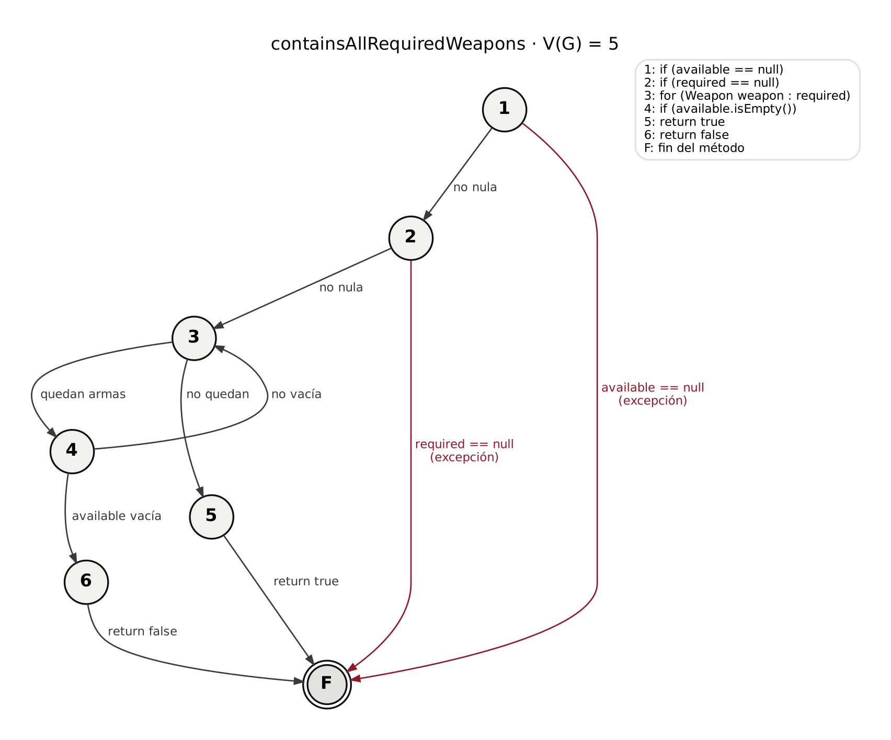
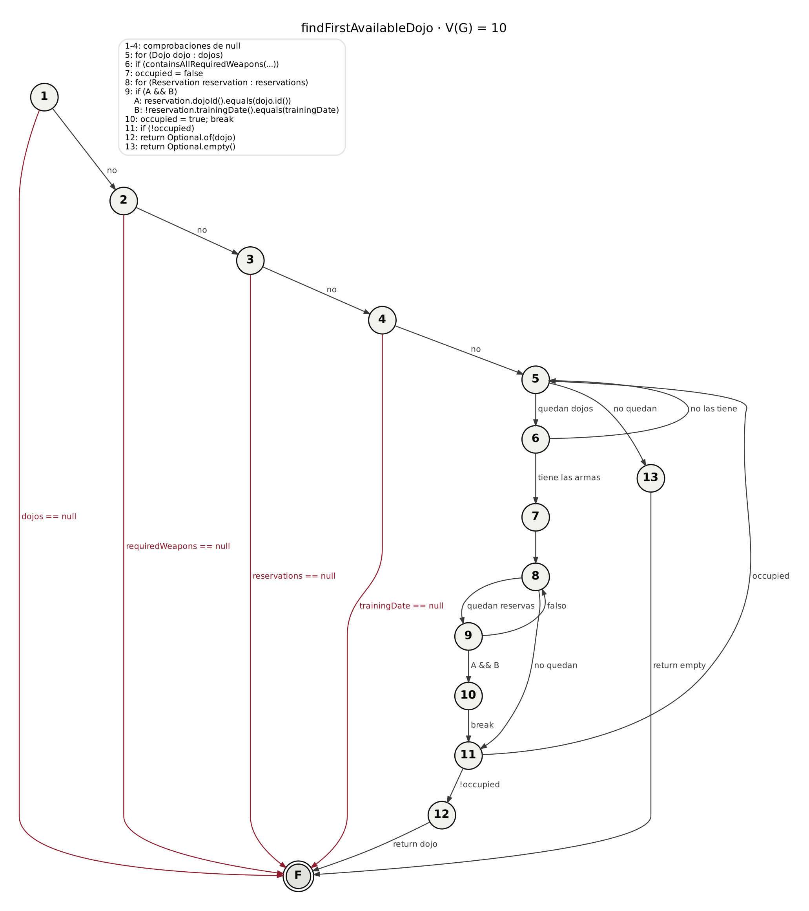
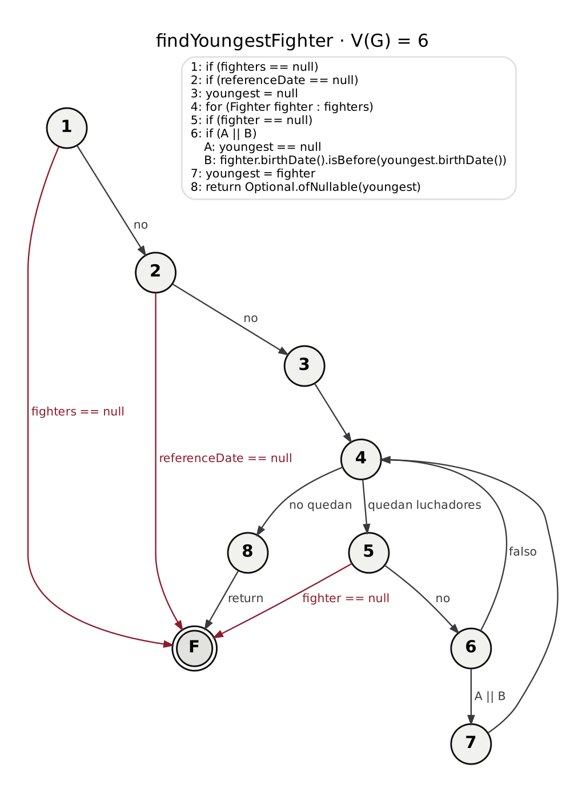
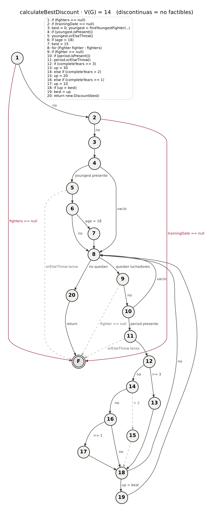
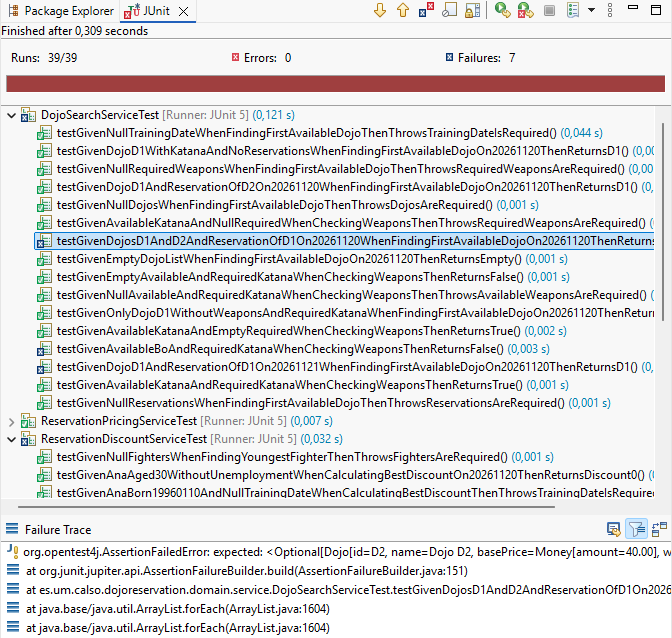
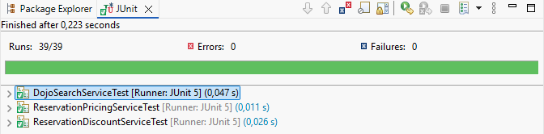

# Práctica 3 — Pruebas de caja blanca y de caja negra

**Caso de estudio:** Dojo Reservation · [Enunciado](docs/ENUNCIADO.md) · [Especificación funcional](docs/ESPECIFICACION.md) · [Guía de pruebas](docs/GUIA_PRUEBAS.md)

---

## 1. Identificación

| Integrante | Responsabilidades | Rama |
|---|---|---|
| Adrián Martínez Zamora | Práctica individual: caja blanca de los cuatro métodos de dominio, cobertura de las dos condiciones seleccionadas, caja negra de las dos pantallas (`/dojos` y `/coste`), análisis de calidad y vídeo | `main` |

Al tratarse de un grupo de un único integrante, todo el trabajo se ha realizado en la rama `main`.

**Uso de herramientas de IA:** se ha utilizado Claude (IA de Anthropic) como herramienta de apoyo: para resolver dudas durante el diseño de caja blanca (grafos, complejidad ciclomática, caminos, datos de prueba y cobertura de condiciones); para generar, a partir de ese diseño, el código de las pruebas JUnit de los apartados 2.1 a 2.4 y de las correcciones D1 a D4; y para elaborar el diseño de caja negra del apartado 3 (clases, límites y casos), las pruebas Selenium y la corrección D5. El autor ha revisado y ejecutado todo el código en Eclipse.

Módulo Maven: [`P3-CalSo-base/`](P3-CalSo-base/) · Workflow: [`.github/workflows/p3-quality.yml`](../.github/workflows/p3-quality.yml)

---

## 2. Caja blanca

### 2.1. `DojoSearchService.containsAllRequiredWeapons`

#### Grafo de flujo

Numeración de los nodos sobre el código:

```java
public boolean containsAllRequiredWeapons(Set<Weapon> available, Set<Weapon> required) {
    if (available == null) {                       // 1
        throw new NullPointerException(...);       //   (1 → F)
    }
    if (required == null) {                        // 2
        throw new NullPointerException(...);       //   (2 → F)
    }
    for (Weapon weapon : required) {               // 3  ¿quedan armas en required?
        if (available.isEmpty()) {                 // 4
            return false;                          // 6
        }
    }
    return true;                                   // 5
}                                                  // F  fin
```

Las salidas por excepción de los nodos 1 y 2 van directamente al nodo final F.

| Desde | Condición | Hacia |
|---|---|---|
| 1 | `available == null` verdadero | F (excepción) |
| 1 | `available == null` falso | 2 |
| 2 | `required == null` verdadero | F (excepción) |
| 2 | `required == null` falso | 3 |
| 3 | quedan armas en `required` | 4 |
| 3 | no quedan armas | 5 |
| 4 | `available.isEmpty()` verdadero | 6 |
| 4 | `available.isEmpty()` falso | 3 |
| 5 | `return true` | F |
| 6 | `return false` | F |



#### Complejidad ciclomática

| Fórmula | Cálculo | Resultado |
|---|---|---|
| V(G) = aristas − nodos + 2 | 10 aristas, 7 nodos (1, 2, 3, 4, 5, 6, F): 10 − 7 + 2 | **5** |
| V(G) = nodos predicado + 1 | Nodos de decisión 1, 2, 3 y 4: 4 + 1 | **5** |
| V(G) = número de regiones | 4 regiones cerradas (entre las dos salidas por excepción; entre la excepción del nodo 2 y el camino 2→3→5→F; el bucle 3→4→3; entre 3→5→F y 3→4→6→F) + 1 exterior | **5** |

#### Caminos independientes

| Camino | Recorrido | Aristas nuevas |
|---|---|---|
| C1 | 1 → F | 1→F |
| C2 | 1 → 2 → F | 1→2, 2→F |
| C3 | 1 → 2 → 3 → 5 → F | 2→3, 3→5, 5→F |
| C4 | 1 → 2 → 3 → 4 → 6 → F | 3→4, 4→6, 6→F |
| C5 | 1 → 2 → 3 → 4 → 3 → 5 → F | 4→3 |

**Recorrido no factible:** 1 → 2 → 3 → 4 → 3 → 4 → 6 → F. Para volver del nodo 4 al 3, `available` no puede estar vacío; como el bucle no modifica `available`, en las siguientes vueltas tampoco estará vacío y el nodo 4 nunca podrá llevar al 6 después de una vuelta completa.

| Método | Nodo o camino identificado | Datos de entrada y fecha | Resultado esperado según especificación | Nombre del test | Resultado ejecución |
|---|---|---|---|---|---|
| `containsAllRequiredWeapons` | C1 | `available = null`, `required = {Katana}` | `NullPointerException` con mensaje `Available weapons are required` | `testGivenNullAvailableAndRequiredKatanaWhenCheckingWeaponsThenThrowsAvailableWeaponsAreRequired` | Pasa |
| `containsAllRequiredWeapons` | C2 | `available = {Katana}`, `required = null` | `NullPointerException` con mensaje `Required weapons are required` | `testGivenAvailableKatanaAndNullRequiredWhenCheckingWeaponsThenThrowsRequiredWeaponsAreRequired` | Pasa |
| `containsAllRequiredWeapons` | C3 | `available = {Katana}`, `required = {}` | `true` (la especificación lo indica también para `required` vacío) | `testGivenAvailableKatanaAndEmptyRequiredWhenCheckingWeaponsThenReturnsTrue` | Pasa |
| `containsAllRequiredWeapons` | C4 | `available = {}`, `required = {Katana}` | `false` | `testGivenEmptyAvailableAndRequiredKatanaWhenCheckingWeaponsThenReturnsFalse` | Pasa |
| `containsAllRequiredWeapons` | C5 (a) | `available = {Katana}`, `required = {Katana}` | `true` | `testGivenAvailableKatanaAndRequiredKatanaWhenCheckingWeaponsThenReturnsTrue` | Pasa |
| `containsAllRequiredWeapons` | C5 (b) | `available = {Bo}`, `required = {Katana}` | `false`: falta la Katana. Con el código actual recorre C5 y devuelve `true`, porque solo comprueba si `available` está vacío | `testGivenAvailableBoAndRequiredKatanaWhenCheckingWeaponsThenReturnsFalse` | Falla con el código original (D1). Pasa tras corregirlo |

Fecha: este método no recibe fechas.

**Defecto previsto en el diseño:** el bucle recorre las armas requeridas pero no utiliza la variable `weapon`; comprueba en cada vuelta si `available` está vacío en lugar de comprobar si contiene el arma requerida. Cualquier dojo con al menos un arma se considera compatible. El caso C5 (b) debe revelarlo al ejecutarse.

### 2.2. `DojoSearchService.findFirstAvailableDojo`

#### Grafo de flujo

Numeración de los nodos sobre el código (las comprobaciones de `null` de los nodos 1 a 4 salen por excepción al nodo final F):

```java
if (dojos == null) throw ...;                                         // 1
if (requiredWeapons == null) throw ...;                               // 2
if (reservations == null) throw ...;                                  // 3
if (trainingDate == null) throw ...;                                  // 4
for (Dojo dojo : dojos) {                                             // 5  ¿quedan dojos?
    if (containsAllRequiredWeapons(dojo.weapons(), requiredWeapons)) { // 6
        boolean occupied = false;                                     // 7
        for (Reservation reservation : reservations) {                // 8  ¿quedan reservas?
            if (reservation.dojoId().equals(dojo.id())
                    && !reservation.trainingDate().equals(trainingDate)) { // 9
                occupied = true;                                      // 10
                break;                                                // 10
            }
        }
        if (!occupied) {                                              // 11
            return Optional.of(dojo);                                 // 12
        }
    }
}
return Optional.empty();                                              // 13
                                                                      // F  fin
```

La decisión compuesta del nodo 9 se trata como un único nodo para los caminos; sus condiciones se analizan en la cobertura de condiciones.

| Desde | Condición | Hacia |
|---|---|---|
| 1, 2, 3, 4 | parámetro `null` | F (excepción) |
| 1, 2, 3 | parámetro no nulo | 2, 3, 4 |
| 4 | `trainingDate` no nulo | 5 |
| 5 | quedan dojos / no quedan | 6 / 13 |
| 6 | el dojo tiene las armas / no las tiene | 7 / 5 |
| 7 | — | 8 |
| 8 | quedan reservas / no quedan | 9 / 11 |
| 9 | la reserva bloquea / no bloquea | 10 / 8 |
| 10 | `break` | 11 |
| 11 | `!occupied` verdadero / falso | 12 / 5 |
| 12, 13 | `return` | F |



#### Complejidad ciclomática

| Fórmula | Cálculo | Resultado |
|---|---|---|
| V(G) = aristas − nodos + 2 | 22 aristas, 14 nodos (1 a 13 y F): 22 − 14 + 2 | **10** |
| V(G) = nodos predicado + 1 | Nodos de decisión 1, 2, 3, 4, 5, 6, 8, 9 y 11: 9 + 1 | **10** |
| V(G) = número de regiones | 9 regiones cerradas + 1 exterior | **10** |

#### Caminos independientes

| Camino | Recorrido | Situación |
|---|---|---|
| C1 | 1 → F | `dojos` nulo |
| C2 | 1 → 2 → F | `requiredWeapons` nulo |
| C3 | 1 → 2 → 3 → F | `reservations` nulo |
| C4 | 1 → 2 → 3 → 4 → F | `trainingDate` nulo |
| C5 | 1 → 2 → 3 → 4 → 5 → 13 → F | lista de dojos vacía |
| C6 | 1 → 2 → 3 → 4 → 5 → 6 → 5 → 13 → F | un dojo sin las armas requeridas |
| C7 | 1 → 2 → 3 → 4 → 5 → 6 → 7 → 8 → 11 → 12 → F | dojo compatible sin reservas |
| C8 | 1 → 2 → 3 → 4 → 5 → 6 → 7 → 8 → 9 → 8 → 11 → 12 → F | dojo compatible con una reserva que no lo bloquea |
| C9 | 1 → 2 → 3 → 4 → 5 → 6 → 7 → 8 → 9 → 10 → 11 → 5 → 13 → F | dojo compatible con una reserva que lo marca como ocupado |
| C10 | 1 → 2 → 3 → 4 → 5 → 6 → 7 → 8 → 11 → 5 → 13 → F | **no factible** |

**Camino no factible C10:** el nodo 7 asigna `occupied = false` y el único nodo que lo modifica es el 10. Si el bucle de reservas termina sin pasar por el nodo 10 (arista 8 → 11), `occupied` sigue valiendo `false`, `!occupied` es verdadero y el nodo 11 va siempre al 12. Nunca puede ir al 5.

| Método | Nodo o camino identificado | Datos de entrada y fecha | Resultado esperado según especificación | Nombre del test | Resultado ejecución |
|---|---|---|---|---|---|
| `findFirstAvailableDojo` | C1 | `dojos = null`, armas {Katana}, sin reservas, 2026-11-20 | `NullPointerException` con mensaje `Dojos are required` | `testGivenNullDojosWhenFindingFirstAvailableDojoThenThrowsDojosAreRequired` | Pasa |
| `findFirstAvailableDojo` | C2 | `dojos = [D1]`, `requiredWeapons = null`, sin reservas, 2026-11-20 | `NullPointerException` con mensaje `Required weapons are required` | `testGivenNullRequiredWeaponsWhenFindingFirstAvailableDojoThenThrowsRequiredWeaponsAreRequired` | Pasa |
| `findFirstAvailableDojo` | C3 | `dojos = [D1]`, armas {Katana}, `reservations = null`, 2026-11-20 | `NullPointerException` con mensaje `Reservations are required` | `testGivenNullReservationsWhenFindingFirstAvailableDojoThenThrowsReservationsAreRequired` | Pasa |
| `findFirstAvailableDojo` | C4 | `dojos = [D1]`, armas {Katana}, sin reservas, `trainingDate = null` | `NullPointerException` con mensaje `Training date is required` | `testGivenNullTrainingDateWhenFindingFirstAvailableDojoThenThrowsTrainingDateIsRequired` | Pasa |
| `findFirstAvailableDojo` | C5 | `dojos = []`, armas {Katana}, sin reservas, 2026-11-20 | `Optional.empty()` | `testGivenEmptyDojoListWhenFindingFirstAvailableDojoOn20261120ThenReturnsEmpty` | Pasa |
| `findFirstAvailableDojo` | C6 | `dojos = [D1 sin armas]`, armas {Katana}, sin reservas, 2026-11-20 | `Optional.empty()`: el dojo no tiene la Katana | `testGivenOnlyDojoD1WithoutWeaponsAndRequiredKatanaWhenFindingFirstAvailableDojoOn20261120ThenReturnsEmpty` | Pasa |
| `findFirstAvailableDojo` | C7 | `dojos = [D1 {Katana}]`, armas {Katana}, sin reservas, 2026-11-20 | `Optional.of(D1)`: nadie lo ha reservado | `testGivenDojoD1WithKatanaAndNoReservationsWhenFindingFirstAvailableDojoOn20261120ThenReturnsD1` | Pasa |
| `findFirstAvailableDojo` | C8 | `dojos = [D1 {Katana}]`, armas {Katana}, reserva de D2 el 2026-11-20, entrenamiento 2026-11-20 | `Optional.of(D1)`: la reserva es de otro dojo | `testGivenDojoD1AndReservationOfD2On20261120WhenFindingFirstAvailableDojoOn20261120ThenReturnsD1` | Pasa |
| `findFirstAvailableDojo` | C9 | `dojos = [D1 {Katana}]`, armas {Katana}, reserva de D1 el 2026-11-21, entrenamiento 2026-11-20 | `Optional.of(D1)`: la reserva es de otro día. Con el código actual devuelve `Optional.empty()` | `testGivenDojoD1AndReservationOfD1On20261121WhenFindingFirstAvailableDojoOn20261120ThenReturnsD1` | Falla con el código original (D2). Pasa tras corregirlo |

**Elección del dato de C6:** se usa un dojo sin ninguna arma. Un dojo con armas distintas de la Katana sería considerado compatible por el defecto previsto en `containsAllRequiredWeapons` y no recorrería C6; así se separa el recorrido del método estudiado de los errores del método auxiliar.

**Defecto previsto en el diseño:** la condición del nodo 9 compara la fecha con `!` delante, de modo que marca el dojo como ocupado cuando la reserva es de **otra** fecha. La especificación indica que solo bloquea una reserva del mismo dojo y la misma fecha exacta. C9 debe revelarlo al ejecutarse.

#### Cobertura de condiciones: decisión `&&` del bucle de reservas

`A = reservation.dojoId().equals(dojo.id())` · `B = !reservation.trainingDate().equals(trainingDate)`

Por el cortocircuito de `&&`, B solo se evalúa cuando A es verdadera.

| Caso | Reserva (entrenamiento el 2026-11-20) | A | B |
|---|---|---|---|
| C8 | D2, 2026-11-20 | falso | no se evalúa |
| C9 | D1, 2026-11-21 | verdadero | verdadero |
| CC1 | D1, 2026-11-20 (con dojos D1 y D2) | verdadero | falso |

| Condición atómica | Caso que evalúa verdadero | Caso que evalúa falso | Casos adicionales | Justificación si no es factible |
|---|---|---|---|---|
| A: `reservation.dojoId().equals(dojo.id())` | C9 | C8 | — | — |
| B: `!reservation.trainingDate().equals(trainingDate)` | C9 | CC1 | CC1: dojos `[D1 {Katana}, D2 {Katana}]`, reserva de D1 el 2026-11-20, entrenamiento el 2026-11-20. Esperado: `Optional.of(D2)`, porque D1 está ocupado y la búsqueda debe continuar. Con el código actual devuelve D1 | B nunca se evalúa con A falsa por el cortocircuito; no impide cubrir sus dos valores |

### 2.3. `ReservationDiscountService.findYoungestFighter`

#### Grafo de flujo

Numeración de los nodos sobre el código (las comprobaciones de `null` salen por excepción al nodo final F):

```java
if (fighters == null) throw ...;                                  // 1
if (referenceDate == null) throw ...;                             // 2
Fighter youngest = null;                                          // 3
for (Fighter fighter : fighters) {                                // 4  ¿quedan luchadores?
    if (fighter == null) throw ...;                               // 5
    if (youngest == null
            || fighter.birthDate().isBefore(youngest.birthDate())) { // 6
        youngest = fighter;                                       // 7
    }
}
return Optional.ofNullable(youngest);                             // 8
                                                                  // F  fin
```

El nodo 3 va separado del 4 porque cada vuelta del bucle vuelve al 4, no al 3. La decisión compuesta del nodo 6 se trata como un único nodo para los caminos.

| Desde | Condición | Hacia |
|---|---|---|
| 1 | `fighters == null` verdadero / falso | F (excepción) / 2 |
| 2 | `referenceDate == null` verdadero / falso | F (excepción) / 3 |
| 3 | — | 4 |
| 4 | quedan luchadores / no quedan | 5 / 8 |
| 5 | `fighter == null` verdadero / falso | F (excepción) / 6 |
| 6 | `A \|\| B` verdadero / falso | 7 / 4 |
| 7 | — | 4 |
| 8 | `return` | F |



#### Complejidad ciclomática

| Fórmula | Cálculo | Resultado |
|---|---|---|
| V(G) = aristas − nodos + 2 | 13 aristas, 9 nodos (1 a 8 y F): 13 − 9 + 2 | **6** |
| V(G) = nodos predicado + 1 | Nodos de decisión 1, 2, 4, 5 y 6: 5 + 1 | **6** |
| V(G) = número de regiones | 5 regiones cerradas + 1 exterior | **6** |

#### Caminos independientes

| Camino | Recorrido | Situación |
|---|---|---|
| C1 | 1 → F | lista nula |
| C2 | 1 → 2 → F | fecha de referencia nula |
| C3 | 1 → 2 → 3 → 4 → 8 → F | lista vacía |
| C4 | 1 → 2 → 3 → 4 → 5 → F | lista con un elemento nulo |
| C5 | 1 → 2 → 3 → 4 → 5 → 6 → 7 → 4 → 8 → F | un solo luchador |
| C6 | 1 → 2 → 3 → 4 → 5 → 6 → 7 → 4 → 5 → 6 → 4 → 8 → F | dos luchadores; el segundo no sustituye al guardado (arista nueva 6 → 4) |

Los seis caminos son factibles. Recorridos imposibles que conviene señalar: en la primera vuelta el nodo 6 no puede ir al 4, porque `youngest` vale `null` y A es verdadera; y a partir de la segunda vuelta A es siempre falsa, porque `youngest` ya no vuelve a valer `null`.

| Método | Nodo o camino identificado | Datos de entrada y fecha | Resultado esperado según especificación | Nombre del test | Resultado ejecución |
|---|---|---|---|---|---|
| `findYoungestFighter` | C1 | `fighters = null`, referencia 2026-11-20 | `NullPointerException` con mensaje `Fighters are required` | `testGivenNullFightersWhenFindingYoungestFighterThenThrowsFightersAreRequired` | Pasa |
| `findYoungestFighter` | C2 | `[Ana (2000-05-10)]`, `referenceDate = null` | `NullPointerException` con mensaje `Reference date is required` | `testGivenAnaBorn20000510AndNullReferenceDateWhenFindingYoungestFighterThenThrowsReferenceDateIsRequired` | Pasa |
| `findYoungestFighter` | C3 | `[]`, referencia 2026-11-20 | `Optional.empty()` | `testGivenEmptyFighterListWhenFindingYoungestFighterThenReturnsEmpty` | Pasa |
| `findYoungestFighter` | C4 | `[null]`, referencia 2026-11-20 | `NullPointerException` con mensaje `Null fighter` | `testGivenListWithNullFighterWhenFindingYoungestFighterThenThrowsNullFighter` | Pasa |
| `findYoungestFighter` | C5 | `[Ana (2000-05-10)]`, referencia 2026-11-20 | `Optional.of(Ana)` | `testGivenOnlyAnaBorn20000510WhenFindingYoungestFighterThenReturnsAna` | Pasa |
| `findYoungestFighter` | C6 | `[Ana (2000-05-10), Bea (2005-03-15)]`, referencia 2026-11-20 | `Optional.of(Bea)`: fecha de nacimiento más reciente. Con el código actual devuelve Ana | `testGivenAnaBorn20000510ThenBeaBorn20050315WhenFindingYoungestFighterThenReturnsBea` | Falla con el código original (D3). Pasa tras corregirlo |

**Defecto previsto en el diseño:** la comparación usa `isBefore`, que se queda con la fecha de nacimiento más **antigua**, es decir, con el luchador de más edad. La especificación pide el de fecha de nacimiento más reciente. C6 debe revelarlo al ejecutarse.

#### Cobertura de condiciones: decisión `||` sobre el luchador más joven

`A = youngest == null` · `B = fighter.birthDate().isBefore(youngest.birthDate())`

Por el cortocircuito de `||`, B solo se evalúa cuando A es falsa, es decir, desde la segunda vuelta del bucle; así se evita llamar a `youngest.birthDate()` con `youngest` nulo.

| Caso | Vuelta | A | B |
|---|---|---|---|
| C5 `[Ana]` | 1.ª | verdadero | no se evalúa |
| C6 `[Ana, Bea]` | 2.ª (Bea) | falso | falso: 2005-03-15 no es anterior a 2000-05-10 |
| CC2 `[Bea, Ana]` | 2.ª (Ana) | falso | verdadero: 2000-05-10 es anterior a 2005-03-15 |

| Condición atómica | Caso que evalúa verdadero | Caso que evalúa falso | Casos adicionales | Justificación si no es factible |
|---|---|---|---|---|
| A: `youngest == null` | C5 | C6 | — | — |
| B: `fighter.birthDate().isBefore(youngest.birthDate())` | CC2 | C6 | CC2: `[Bea (2005-03-15), Ana (2000-05-10)]`, referencia 2026-11-20. Esperado: `Optional.of(Bea)`. Con el código actual devuelve Ana | B no puede evaluarse con A verdadera: en la primera vuelta lo impide el cortocircuito y desde la segunda A es siempre falsa. No impide cubrir sus dos valores |

**Tras corregir D3:** la condición B pasa a ser `fighter.birthDate().isAfter(youngest.birthDate())`. Las tablas de cobertura de condiciones de 2.3 describen el código original; con el código corregido, C6 evalúa B verdadera y CC2 la evalúa falsa, así que B sigue cubierta en sus dos valores con las mismas pruebas.

### 2.4. `ReservationDiscountService.calculateBestDiscount`

#### Grafo de flujo

Numeración de los nodos sobre el código. Las comprobaciones de `null` y los dos `orElseThrow()` salen por excepción al nodo final F. Cada `orElseThrow()` se modela como una decisión (¿el `Optional` está vacío?), porque la especificación indica que forman parte del código que debe analizarse aunque no todas sus ramas excepcionales sean ejecutables. La llamada a `findYoungestFighter` del nodo 3 se trata como una instrucción; sus caminos internos se analizan en el apartado 2.3.

```java
if (fighters == null) throw ...;                                   // 1
if (trainingDate == null) throw ...;                               // 2
int bestPercentage = 0;                                            // 3
Optional<Fighter> youngest = findYoungestFighter(fighters, trainingDate);  // 3
if (youngest.isPresent()) {                                        // 4
    int age = youngest.orElseThrow().ageAt(trainingDate);          // 5
    if (age < 18) {                                                // 6
        bestPercentage = 15;                                       // 7
    }
}
for (Fighter fighter : fighters) {                                 // 8  ¿quedan luchadores?
    if (fighter == null) throw ...;                                // 9
    Optional<UnemploymentPeriod> period = fighter.unemployment();
    if (period.isPresent()) {                                      // 10
        long completeYears = period.orElseThrow().completeYearsAt(trainingDate);  // 11
        int unemploymentPercentage = 0;
        if (completeYears >= 3) {                                  // 12
            unemploymentPercentage = 30;                           // 13
        } else if (completeYears > 2) {                            // 14
            unemploymentPercentage = 20;                           // 15
        } else if (completeYears >= 1) {                           // 16
            unemploymentPercentage = 10;                           // 17
        }
        if (unemploymentPercentage > bestPercentage) {             // 18
            bestPercentage = unemploymentPercentage;               // 19
        }
    }
}
return new Discount(bestPercentage);                               // 20
                                                                   // F  fin
```

| Desde | Condición | Hacia |
|---|---|---|
| 1 | `fighters == null` verdadero / falso | F (excepción) / 2 |
| 2 | `trainingDate == null` verdadero / falso | F (excepción) / 3 |
| 3 | — | 4 |
| 4 | `youngest` presente / vacío | 5 / 8 |
| 5 | `orElseThrow()` lanza / devuelve el luchador | F (excepción) / 6 |
| 6 | `age < 18` verdadero / falso | 7 / 8 |
| 7 | — | 8 |
| 8 | quedan luchadores / no quedan | 9 / 20 |
| 9 | `fighter == null` verdadero / falso | F (excepción) / 10 |
| 10 | `period` presente / vacío | 11 / 8 |
| 11 | `orElseThrow()` lanza / devuelve el período | F (excepción) / 12 |
| 12 | `completeYears >= 3` verdadero / falso | 13 / 14 |
| 13 | — | 18 |
| 14 | `completeYears > 2` verdadero / falso | 15 / 16 |
| 15 | — | 18 |
| 16 | `completeYears >= 1` verdadero / falso | 17 / 18 |
| 17 | — | 18 |
| 18 | `unemploymentPercentage > bestPercentage` verdadero / falso | 19 / 8 |
| 19 | — | 8 |
| 20 | `return` | F |



En el grafo, las aristas discontinuas son las que no se pueden recorrer.

#### Complejidad ciclomática

| Fórmula | Cálculo | Resultado |
|---|---|---|
| V(G) = aristas − nodos + 2 | 33 aristas, 21 nodos (1 a 20 y F): 33 − 21 + 2 | **14** |
| V(G) = nodos predicado + 1 | Nodos de decisión 1, 2, 4, 5, 6, 8, 9, 10, 11, 12, 14, 16 y 18: 13 + 1 | **14** |
| V(G) = número de regiones | 13 regiones cerradas + 1 exterior | **14** |

Si no se modelaran los dos `orElseThrow()` como decisiones, V(G) sería 12.

#### Caminos independientes

Para abreviar, **P** = 1 → 2 → 3 → 4 → 5 → 6, comienzo común de los caminos que llegan al bucle con al menos un luchador.

| Camino | Recorrido | Situación | Factible |
|---|---|---|---|
| C1 | 1 → F | lista nula | Sí |
| C2 | 1 → 2 → F | fecha de entrenamiento nula | Sí |
| C3 | 1 → 2 → 3 → 4 → 8 → 20 → F | lista vacía | Sí |
| C4 | 1 → 2 → 3 → 4 → 5 → F | `youngest.orElseThrow()` lanza | **No** |
| C5 | P → 8 → 9 → 10 → 8 → 20 → F | adulto sin paro | Sí |
| C6 | P → 7 → 8 → 9 → 10 → 8 → 20 → F | menor sin paro | Sí |
| C7 | P → 8 → 9 → F | luchador nulo dentro del bucle | **No** |
| C8 | P → 8 → 9 → 10 → 11 → F | `period.orElseThrow()` lanza | **No** |
| C9 | P → 8 → 9 → 10 → 11 → 12 → 13 → 18 → 19 → 8 → 20 → F | adulto con 3 años o más de paro | Sí |
| C10 | P → 8 → 9 → 10 → 11 → 12 → 14 → 16 → 18 → 8 → 20 → F | adulto con menos de 1 año de paro | Sí |
| C11 | P → 8 → 9 → 10 → 11 → 12 → 14 → 16 → 17 → 18 → 19 → 8 → 20 → F | adulto con 1 año de paro | Sí |
| C12 | P → 8 → 9 → 10 → 11 → 12 → 14 → 15 → 18 → 19 → 8 → 20 → F | rama del 20 % | **No** |
| C13 | P → 7 → 8 → 9 → 10 → 11 → 12 → 14 → 16 → 17 → 18 → 8 → 20 → F | menor con 1 año de paro: el 10 % no supera el 15 % | Sí |
| C14 | P → 8 → 9 → 10 → 11 → 12 → 13 → 18 → 19 → 8 → 9 → 10 → 11 → 12 → 14 → 16 → 17 → 18 → 8 → 20 → F | dos luchadores en paro: el segundo (10 %) no supera al primero (30 %) | Sí |

C13 y C14 no añaden aristas nuevas, pero son linealmente independientes de los anteriores: combinan las ramas de otra forma y completan la base de 14 caminos.

**Caminos no factibles:**

| Camino | Arista imposible | Justificación |
|---|---|---|
| C4 | 5 → F | Al nodo 5 solo se llega si `youngest.isPresent()` es verdadero. Un `Optional` con valor nunca lanza en `orElseThrow()`. |
| C7 | 9 → F | El nodo 3 llama antes a `findYoungestFighter`, que recorre toda la lista y lanza `NullPointerException("Null fighter")` si encuentra un elemento nulo. Una lista con un nulo nunca llega al nodo 9; la excepción se produce dentro del método auxiliar. |
| C8 | 11 → F | Al nodo 11 solo se llega si `period.isPresent()` es verdadero, con el mismo razonamiento que en C4. |
| C12 | 14 → 15 | `completeYears` es entero. Para llegar al nodo 14, el 12 ha descartado los valores mayores o iguales que 3, así que solo llegan 0, 1 o 2, y ninguno es mayor que 2. **Es un defecto:** la especificación asigna un 20 % de 2 a menos de 3 años. |

Fecha de entrenamiento de todos los casos: **2026-11-20**. Ana nació el 1996-01-10 (30 años), Bea el 2009-06-01 (17 años) y Carlos el 1990-02-02. Las fechas de inicio del paro son posteriores a los 16 años de cada luchador.

| Método | Nodo o camino identificado | Datos de entrada y fecha | Resultado esperado según especificación | Nombre del test | Resultado ejecución |
|---|---|---|---|---|---|
| `calculateBestDiscount` | C1 | `fighters = null`, 2026-11-20 | `NullPointerException` con mensaje `Fighters are required` | `testGivenNullFightersWhenCalculatingBestDiscountThenThrowsFightersAreRequired` | Pasa |
| `calculateBestDiscount` | C2 | `[Ana]`, `trainingDate = null` | `NullPointerException` con mensaje `Training date is required` | `testGivenAnaBorn19960110AndNullTrainingDateWhenCalculatingBestDiscountThenThrowsTrainingDateIsRequired` | Pasa |
| `calculateBestDiscount` | C3 | `[]`, 2026-11-20 | `Discount(0)` | `testGivenEmptyFighterListWhenCalculatingBestDiscountOn20261120ThenReturnsDiscount0` | Pasa |
| `calculateBestDiscount` | C5 | `[Ana]` sin paro, 2026-11-20 | `Discount(0)` | `testGivenAnaAged30WithoutUnemploymentWhenCalculatingBestDiscountOn20261120ThenReturnsDiscount0` | Pasa |
| `calculateBestDiscount` | C6 | `[Bea]` sin paro, 2026-11-20 | `Discount(15)` | `testGivenBeaAged17WithoutUnemploymentWhenCalculatingBestDiscountOn20261120ThenReturnsDiscount15` | Pasa |
| `calculateBestDiscount` | C9 | `[Ana]` en paro desde 2023-11-20 (3 años justos), 2026-11-20 | `Discount(30)` | `testGivenAnaUnemployedSince20231120WhenCalculatingBestDiscountOn20261120ThenReturnsDiscount30` | Pasa |
| `calculateBestDiscount` | C10 | `[Ana]` en paro desde 2026-05-01 (0 años), 2026-11-20 | `Discount(0)` | `testGivenAnaUnemployedSince20260501WhenCalculatingBestDiscountOn20261120ThenReturnsDiscount0` | Pasa |
| `calculateBestDiscount` | C11 | `[Ana]` en paro desde 2025-11-20 (1 año justo), 2026-11-20 | `Discount(10)` | `testGivenAnaUnemployedSince20251120WhenCalculatingBestDiscountOn20261120ThenReturnsDiscount10` | Pasa |
| `calculateBestDiscount` | C13 | `[Bea]` en paro desde 2025-06-01 (1 año), 2026-11-20 | `Discount(15)`: no se suman, gana el mayor | `testGivenBeaAged17UnemployedSince20250601WhenCalculatingBestDiscountOn20261120ThenReturnsDiscount15` | Pasa |
| `calculateBestDiscount` | C14 | `[Ana` en paro desde 2023-11-20, `Carlos` en paro desde 2025-11-20`]`, 2026-11-20 | `Discount(30)`: el mayor de 30 y 10 | `testGivenAnaUnemployed3YearsThenCarlosUnemployed1YearWhenCalculatingBestDiscountOn20261120ThenReturnsDiscount30` | Pasa |
| `calculateBestDiscount` | Adicional: 2 años de paro (dato de C12) | `[Ana]` en paro desde 2024-11-20 (2 años justos), 2026-11-20 | `Discount(20)`. Con el código actual da `Discount(10)` | `testGivenAnaUnemployedSince20241120WhenCalculatingBestDiscountOn20261120ThenReturnsDiscount20` | Falla con el código original (D4). Pasa tras corregirlo |
| `calculateBestDiscount` | Adicional: adulto y menor | `[Ana, Bea]` sin paro, 2026-11-20 | `Discount(15)`: la más joven tiene 17 años. Con el código actual da `Discount(0)`, porque `findYoungestFighter` devuelve a Ana | `testGivenAnaAged30AndBeaAged17WhenCalculatingBestDiscountOn20261120ThenReturnsDiscount15` | Falla con el código original (D3). Pasa tras corregirlo |

**Defectos previstos en el diseño:**

- La condición `completeYears > 2` hace inalcanzable el 20 %: un luchador con 2 años completos de paro recibe un 10 %. Lo revela la prueba adicional de 2 años.
- El descuento juvenil depende de `findYoungestFighter`, que devuelve al luchador de más edad (apartado 2.3). Un equipo con un adulto y un menor pierde el 15 %. No es un defecto de este método: se corrige en `findYoungestFighter`, y al hacerlo esta prueba debe pasar también a verde (regresión).

### 2.5. Trazabilidad

#### Camino → prueba

Pruebas en [`DojoSearchServiceTest`](P3-CalSo-base/src/test/java/es/um/calso/dojoreservation/domain/service/DojoSearchServiceTest.java) (apartados 2.1 y 2.2) y [`ReservationDiscountServiceTest`](P3-CalSo-base/src/test/java/es/um/calso/dojoreservation/domain/service/ReservationDiscountServiceTest.java) (apartados 2.3 y 2.4).

| Método | Camino | Prueba JUnit |
|---|---|---|
| `containsAllRequiredWeapons` | C1 | `testGivenNullAvailableAndRequiredKatanaWhenCheckingWeaponsThenThrowsAvailableWeaponsAreRequired` |
| `containsAllRequiredWeapons` | C2 | `testGivenAvailableKatanaAndNullRequiredWhenCheckingWeaponsThenThrowsRequiredWeaponsAreRequired` |
| `containsAllRequiredWeapons` | C3 | `testGivenAvailableKatanaAndEmptyRequiredWhenCheckingWeaponsThenReturnsTrue` |
| `containsAllRequiredWeapons` | C4 | `testGivenEmptyAvailableAndRequiredKatanaWhenCheckingWeaponsThenReturnsFalse` |
| `containsAllRequiredWeapons` | C5 (a) | `testGivenAvailableKatanaAndRequiredKatanaWhenCheckingWeaponsThenReturnsTrue` |
| `containsAllRequiredWeapons` | C5 (b) | `testGivenAvailableBoAndRequiredKatanaWhenCheckingWeaponsThenReturnsFalse` |
| `findFirstAvailableDojo` | C1 | `testGivenNullDojosWhenFindingFirstAvailableDojoThenThrowsDojosAreRequired` |
| `findFirstAvailableDojo` | C2 | `testGivenNullRequiredWeaponsWhenFindingFirstAvailableDojoThenThrowsRequiredWeaponsAreRequired` |
| `findFirstAvailableDojo` | C3 | `testGivenNullReservationsWhenFindingFirstAvailableDojoThenThrowsReservationsAreRequired` |
| `findFirstAvailableDojo` | C4 | `testGivenNullTrainingDateWhenFindingFirstAvailableDojoThenThrowsTrainingDateIsRequired` |
| `findFirstAvailableDojo` | C5 | `testGivenEmptyDojoListWhenFindingFirstAvailableDojoOn20261120ThenReturnsEmpty` |
| `findFirstAvailableDojo` | C6 | `testGivenOnlyDojoD1WithoutWeaponsAndRequiredKatanaWhenFindingFirstAvailableDojoOn20261120ThenReturnsEmpty` |
| `findFirstAvailableDojo` | C7 | `testGivenDojoD1WithKatanaAndNoReservationsWhenFindingFirstAvailableDojoOn20261120ThenReturnsD1` |
| `findFirstAvailableDojo` | C8 | `testGivenDojoD1AndReservationOfD2On20261120WhenFindingFirstAvailableDojoOn20261120ThenReturnsD1` |
| `findFirstAvailableDojo` | C9 | `testGivenDojoD1AndReservationOfD1On20261121WhenFindingFirstAvailableDojoOn20261120ThenReturnsD1` |
| `findFirstAvailableDojo` | CC1 (cobertura de condiciones) | `testGivenDojosD1AndD2AndReservationOfD1On20261120WhenFindingFirstAvailableDojoOn20261120ThenReturnsD2` |
| `findYoungestFighter` | C1 | `testGivenNullFightersWhenFindingYoungestFighterThenThrowsFightersAreRequired` |
| `findYoungestFighter` | C2 | `testGivenAnaBorn20000510AndNullReferenceDateWhenFindingYoungestFighterThenThrowsReferenceDateIsRequired` |
| `findYoungestFighter` | C3 | `testGivenEmptyFighterListWhenFindingYoungestFighterThenReturnsEmpty` |
| `findYoungestFighter` | C4 | `testGivenListWithNullFighterWhenFindingYoungestFighterThenThrowsNullFighter` |
| `findYoungestFighter` | C5 | `testGivenOnlyAnaBorn20000510WhenFindingYoungestFighterThenReturnsAna` |
| `findYoungestFighter` | C6 | `testGivenAnaBorn20000510ThenBeaBorn20050315WhenFindingYoungestFighterThenReturnsBea` |
| `findYoungestFighter` | CC2 (cobertura de condiciones) | `testGivenBeaBorn20050315ThenAnaBorn20000510WhenFindingYoungestFighterThenReturnsBea` |
| `calculateBestDiscount` | C1 | `testGivenNullFightersWhenCalculatingBestDiscountThenThrowsFightersAreRequired` |
| `calculateBestDiscount` | C2 | `testGivenAnaBorn19960110AndNullTrainingDateWhenCalculatingBestDiscountThenThrowsTrainingDateIsRequired` |
| `calculateBestDiscount` | C3 | `testGivenEmptyFighterListWhenCalculatingBestDiscountOn20261120ThenReturnsDiscount0` |
| `calculateBestDiscount` | C5 | `testGivenAnaAged30WithoutUnemploymentWhenCalculatingBestDiscountOn20261120ThenReturnsDiscount0` |
| `calculateBestDiscount` | C6 | `testGivenBeaAged17WithoutUnemploymentWhenCalculatingBestDiscountOn20261120ThenReturnsDiscount15` |
| `calculateBestDiscount` | C9 | `testGivenAnaUnemployedSince20231120WhenCalculatingBestDiscountOn20261120ThenReturnsDiscount30` |
| `calculateBestDiscount` | C10 | `testGivenAnaUnemployedSince20260501WhenCalculatingBestDiscountOn20261120ThenReturnsDiscount0` |
| `calculateBestDiscount` | C11 | `testGivenAnaUnemployedSince20251120WhenCalculatingBestDiscountOn20261120ThenReturnsDiscount10` |
| `calculateBestDiscount` | C13 | `testGivenBeaAged17UnemployedSince20250601WhenCalculatingBestDiscountOn20261120ThenReturnsDiscount15` |
| `calculateBestDiscount` | C14 | `testGivenAnaUnemployed3YearsThenCarlosUnemployed1YearWhenCalculatingBestDiscountOn20261120ThenReturnsDiscount30` |
| `calculateBestDiscount` | Adicional: 2 años de paro (dato de C12) | `testGivenAnaUnemployedSince20241120WhenCalculatingBestDiscountOn20261120ThenReturnsDiscount20` |
| `calculateBestDiscount` | Adicional: adulto y menor | `testGivenAnaAged30AndBeaAged17WhenCalculatingBestDiscountOn20261120ThenReturnsDiscount15` |

#### Condición atómica / valor → prueba

| Decisión | Condición atómica | Valor | Prueba JUnit |
|---|---|---|---|
| `findFirstAvailableDojo`, bucle de reservas (`&&`) | A: `reservation.dojoId().equals(dojo.id())` | verdadero | `testGivenDojoD1AndReservationOfD1On20261121WhenFindingFirstAvailableDojoOn20261120ThenReturnsD1` (C9) |
| | A | falso | `testGivenDojoD1AndReservationOfD2On20261120WhenFindingFirstAvailableDojoOn20261120ThenReturnsD1` (C8) |
| | B: `!reservation.trainingDate().equals(trainingDate)` | verdadero | `testGivenDojoD1AndReservationOfD1On20261121WhenFindingFirstAvailableDojoOn20261120ThenReturnsD1` (C9) |
| | B | falso | `testGivenDojosD1AndD2AndReservationOfD1On20261120WhenFindingFirstAvailableDojoOn20261120ThenReturnsD2` (CC1) |
| `findYoungestFighter`, luchador más joven (`\|\|`) | A: `youngest == null` | verdadero | `testGivenOnlyAnaBorn20000510WhenFindingYoungestFighterThenReturnsAna` (C5) |
| | A | falso | `testGivenAnaBorn20000510ThenBeaBorn20050315WhenFindingYoungestFighterThenReturnsBea` (C6, segunda vuelta) |
| | B: `fighter.birthDate().isBefore(youngest.birthDate())` | verdadero | `testGivenBeaBorn20050315ThenAnaBorn20000510WhenFindingYoungestFighterThenReturnsBea` (CC2) |
| | B | falso | `testGivenAnaBorn20000510ThenBeaBorn20050315WhenFindingYoungestFighterThenReturnsBea` (C6) |

---

## 3. Caja negra

Pruebas Selenium en [`DojoSearchE2ETest`](P3-CalSo-base/src/test/java/es/um/calso/dojoreservation/infrastructure/e2e/DojoSearchE2ETest.java) y [`ReservationCostE2ETest`](P3-CalSo-base/src/test/java/es/um/calso/dojoreservation/infrastructure/e2e/ReservationCostE2ETest.java), con la clase de apoyo suministrada `BrowserE2ESupport`.

**Estado inicial común a todos los casos:**
- **Reloj del perfil `e2e`:** fijo en **2026-10-20** (Europe/Madrid). Hoy es 2026-10-20 y el primer día válido es el 2026-10-21.
- **Catálogo `InMemoryCatalog`, sin modificar:**

| Elemento | Datos relevantes |
|---|---|
| EQ-001 | Requiere Katana y Bokken. Hana nace el 2009-11-20 (menor hasta el 2027-11-19); Akira está en paro desde el 2024-11-20 |
| EQ-002 | Requiere Bo. Cinco adultos sin paro |
| EQ-003 | Requiere Bo. Nora nace el 2009-11-20: cumple 18 años el 2027-11-20 |
| EQ-004 | Requiere Bo. Izan está en paro desde el 2025-11-20: 1 año el 2026-11-20 y 2 años el 2027-11-20 |
| EQ-005 | Requiere Bo. Lea está en paro desde el 2024-11-20: 3 años el 2027-11-20 |
| Dojos, en orden de selección | D-001 (40,00 €; Katana y Bokken), D-002 (50,00 €; Katana, Bokken y Bo), D-003 (35,00 €; Bo) |
| Reservas | D-001 el 2026-11-20 y el 2027-11-20 |

Los desplegables solo ofrecen identificadores conocidos. Los identificadores vacíos, en blanco o inexistentes, y las fechas imposibles, se prueban abriendo la URL con parámetros. Así se comprueba la validación del servidor.

### 3.1. Búsqueda de dojos (`/dojos`)

#### Clases de equivalencia

| Código de clase | Variable | Condición de pertenencia | Válida / inválida | Comportamiento exigido |
|---|---|---|---|---|
| T1 | `teamId` | Identificador de un equipo existente (EQ-001 a EQ-005) | Válida | Se evalúan los dojos para ese equipo |
| T2 | `teamId` | En blanco (solo espacios) | Inválida | `Team id is required` |
| T3 | `teamId` | Vacío (`teamId=`) | Inválida | `Team id is required` |
| T4 | `teamId` | Con formato de identificador, pero no existe (EQ-999) | Inválida | `Team does not exist` |
| F1 | `trainingDate` | Posterior a la fecha actual (después del 2026-10-20) | Válida | Se realiza la búsqueda |
| F2 | `trainingDate` | Igual a la fecha actual (2026-10-20) | Inválida | `Training date must be in the future` |
| F3 | `trainingDate` | Anterior a la fecha actual | Inválida | `Training date must be in the future` |
| F4 | `trainingDate` | Fecha imposible enviada por HTTP (2026-13-40) | Inválida | Spring MVC la rechaza antes de ejecutar el controlador. No se presupone el mensaje de fecha no futura |
| R1 | Estado | El primer dojo de la lista es compatible y está libre | Válida | Se selecciona ese dojo |
| R2 | Estado | El primer dojo compatible está reservado para esa fecha | Válida | Se marca como ocupado y la búsqueda continúa con el siguiente compatible |
| R3 | Estado | La reserva del dojo compatible es de otro día | Válida | La reserva no bloquea: se selecciona ese dojo |
| R4 | Estado | El primer dojo de la lista no tiene todas las armas requeridas | Válida | Se descarta y se selecciona el siguiente compatible y libre |
| R5 | Estado | Ningún dojo es compatible y libre | Válida | Mensaje de ausencia de dojo (`#no-dojo`) |

**R5 no se puede producir con el catálogo suministrado.** EQ-001 es compatible con D-001 y D-002, pero solo D-001 tiene reservas. Los equipos que requieren Bo son compatibles con D-002 y D-003, que no tienen ninguna. Como los datos del catálogo no deben alterarse, R5 queda identificada pero sin caso E2E.

#### Valores límite

| Variable | Valor del límite | Valor elegido | Expectativas |
|---|---|---|---|
| `trainingDate` frente al reloj | 2026-10-20 (hoy) | 2026-10-19 (antes) | `Training date must be in the future` |
| | | 2026-10-20 (en) | `Training date must be in the future` |
| | | 2026-10-21 (después) | Búsqueda válida: EQ-001 obtiene D-001 |
| `trainingDate` frente a la reserva de D-001 | 2026-11-20 | 2026-11-19 (antes) | D-001 libre y seleccionado |
| | | 2026-11-20 (en) | D-001 ocupado; se selecciona D-002 |
| | | 2026-11-21 (después) | D-001 libre y seleccionado |

#### Casos de prueba

| ID del caso | Clases cubiertas | Equipo/dojo/fecha o URL concreta | Estado inicial | Resultado único esperado | Nombre prueba |
|---|---|---|---|---|---|
| CB1 | T1, F1, R1; límite «después» del reloj | EQ-001, 2026-10-21 | Reloj 2026-10-20, catálogo | `#dojo-id` = `D-001` | `testGivenTeamEq001AndTomorrow20261021WhenSearchingDojosThenSelectsD001` |
| CB2 | F2; límite «en» del reloj | EQ-001, 2026-10-20 | Reloj 2026-10-20 | `#error` = `Training date must be in the future` | `testGivenTeamEq001AndToday20261020WhenSearchingDojosThenShowsTrainingDateMustBeInTheFuture` |
| CB3 | F3; límite «antes» del reloj | EQ-001, 2026-10-19 | Reloj 2026-10-20 | `#error` = `Training date must be in the future` | `testGivenTeamEq001AndYesterday20261019WhenSearchingDojosThenShowsTrainingDateMustBeInTheFuture` |
| CB4 | T1, F1, R2; límite «en» de la reserva | EQ-001, 2026-11-20 | Reserva de D-001 el 2026-11-20 | `#dojo-id` = `D-002` | `testGivenTeamEq001AndD001Reserved20261120WhenSearchingDojosOn20261120ThenSelectsD002` |
| CB5 | R2 (misma entrada que CB4, otra salida) | EQ-001, 2026-11-20 | Reserva de D-001 el 2026-11-20 | La fila `data-dojo-id='D-001'` indica `Ocupado` | `testGivenTeamEq001AndD001Reserved20261120WhenSearchingDojosOn20261120ThenD001RowShowsOcupado` |
| CB6 | R3; límite «antes» de la reserva | EQ-001, 2026-11-19 | Reserva de D-001 el 2026-11-20 | `#dojo-id` = `D-001` | `testGivenTeamEq001AndD001Reserved20261120WhenSearchingDojosOn20261119ThenSelectsD001` |
| CB7 | R3; límite «después» de la reserva | EQ-001, 2026-11-21 | Reserva de D-001 el 2026-11-20 | `#dojo-id` = `D-001` | `testGivenTeamEq001AndD001Reserved20261120WhenSearchingDojosOn20261121ThenSelectsD001` |
| CB8 | T1, F1, R4 | EQ-002, 2026-11-20 | D-001 no tiene Bo | `#dojo-id` = `D-002` | `testGivenTeamEq002RequiringBoWhenSearchingDojosOn20261120ThenSelectsD002` |
| CB9 | T4 | `/dojos?teamId=EQ-999&trainingDate=2026-11-20` | Catálogo sin EQ-999 | `#error` = `Team does not exist` | `testGivenUnknownTeamEq999InUrlWhenSearchingDojosOn20261120ThenShowsTeamDoesNotExist` |
| CB10 | T2 | `/dojos?teamId=%20&trainingDate=2026-11-20` | — | `#error` = `Team id is required` | `testGivenBlankTeamIdInUrlWhenSearchingDojosOn20261120ThenShowsTeamIdIsRequired` |
| CB11 | T3 | `/dojos?teamId=&trainingDate=2026-11-20` | — | `#error` = `Team id is required` | `testGivenEmptyTeamIdInUrlWhenSearchingDojosOn20261120ThenShowsTeamIdIsRequired` |
| CB12 | F4 | `/dojos?teamId=EQ-001&trainingDate=2026-13-40` | — | No se muestra la pantalla de búsqueda (no existe `#search`): la petición se rechaza antes del controlador | `testGivenImpossibleDate20261340InUrlWhenSearchingDojosThenSearchScreenIsNotShown` |

### 3.2. Coste y bonificaciones (`/coste`)

#### Clases de equivalencia

| Código de clase | Variable | Condición de pertenencia | Válida / inválida | Comportamiento exigido |
|---|---|---|---|---|
| T1 | `teamId` | Equipo existente | Válida | Se calcula el coste |
| T2 | `teamId` | En blanco (solo espacios) | Inválida | `Team id is required` |
| T3 | `teamId` | Vacío (`teamId=`) | Inválida | `Team id is required` |
| T4 | `teamId` | No existe (EQ-999) | Inválida | `Team does not exist` |
| D1 | `dojoId` | Dojo existente (D-001 a D-003) | Válida | Precio base del dojo |
| D2 | `dojoId` | En blanco (solo espacios) | Inválida | `Dojo id is required` |
| D3 | `dojoId` | Vacío (`dojoId=`) | Inválida | `Dojo id is required` |
| D4 | `dojoId` | No existe (D-999) | Inválida | `Dojo does not exist` |
| F1 | `trainingDate` | Posterior a la fecha actual | Válida | Se calcula el coste |
| F2 | `trainingDate` | Igual a la fecha actual (2026-10-20) | Inválida | `Training date must be in the future` |
| F3 | `trainingDate` | Anterior a la fecha actual | Inválida | `Training date must be in the future` |
| A1 | Armas requeridas por el equipo | 1 arma distinta | Válida | Suplemento de 5,00 € |
| A2 | Armas requeridas por el equipo | 2 armas distintas | Válida | Suplemento de 10,00 € |
| B0 | Bonificación | Ningún menor de 18 años ni ningún luchador en paro | Válida | 0 % |
| B1 | Bonificación | El más joven tiene menos de 18 años y no hay paro | Válida | 15 % |
| B2 | Bonificación | Paro de menos de 1 año completo | Válida | 0 % |
| B3 | Bonificación | Paro de 1 a menos de 2 años | Válida | 10 % |
| B4 | Bonificación | Paro de 2 a menos de 3 años | Válida | 20 % |
| B5 | Bonificación | Paro de 3 años o más | Válida | 30 % |
| B6 | Bonificación | Concurren juventud y paro | Válida | Solo el porcentaje mayor; nunca la suma |
| R1 | Estado | El dojo tiene una reserva en la fecha pedida | Válida | El presupuesto se calcula igual: calcular un coste no es reservar |

#### Valores límite

| Variable | Valor del límite | Valor elegido | Expectativas |
|---|---|---|---|
| `trainingDate` frente al reloj | 2026-10-20 (hoy) | 2026-10-19 (antes) | `Training date must be in the future` |
| | | 2026-10-20 (en) | `Training date must be in the future` |
| | | 2026-10-21 (después) | Coste calculado |
| Edad del más joven (EQ-003) | 18 años: el 2027-11-20 | 2027-11-19 (antes) | 15 % |
| | | 2027-11-20 (en) | 0 % |
| | | 2027-11-21 (después) | 0 % |
| Años de paro (EQ-004) | 1 año: el 2026-11-20 | 2026-11-19 (antes) | 0 % |
| | | 2026-11-20 (en) | 10 % |
| Años de paro (EQ-004) | 2 años: el 2027-11-20 | 2027-11-19 (antes) | 10 % |
| | | 2027-11-20 (en) | 20 % |
| Años de paro (EQ-005) | 3 años: el 2027-11-20 | 2027-11-19 (antes) | 20 % |
| | | 2027-11-20 (en) | 30 % |

En los límites de paro no se añade el valor «después» porque coincide con la clase del valor «en». En cambio, el de 18 años sí se añade, porque es la frontera de la regla de juventud.

#### Casos de prueba

| ID del caso | Clases cubiertas | Equipo/dojo/fecha o URL concreta | Estado inicial | Resultado único esperado | Nombre prueba |
|---|---|---|---|---|---|
| CO1 | T1, D1, F1, A1 | EQ-002, D-001, 2026-10-21 | Cinco adultos sin paro | `#weapons-price` = `5.00` | `testGivenTeamEq002RequiringOneWeaponAndDojoD001WhenCalculatingCostOn20261021ThenWeaponSupplementIs500` |
| CO2 | A2 | EQ-001, D-001, 2026-10-21 | Hana (menor), Akira en paro desde 2024-11-20 | `#weapons-price` = `10.00` | `testGivenTeamEq001RequiringTwoWeaponsAndDojoD001WhenCalculatingCostOn20261021ThenWeaponSupplementIs1000` |
| CO3 | T1, D1, F1, A1 | EQ-002, D-002, 2026-10-21 | Cinco adultos sin paro | `#subtotal` = `55.00` (50,00 + 5,00) | `testGivenTeamEq002AndDojoD002WhenCalculatingCostOn20261021ThenSubtotalIs5500` |
| CO4 | B0; límite «después» del reloj | EQ-002, D-003, 2026-10-21 | Cinco adultos sin paro | `#final-price` = `40.00` (40,00 sin bonificación) | `testGivenTeamEq002WithoutDiscountAndDojoD003WhenCalculatingCostOn20261021ThenFinalPriceIs4000` |
| CO5 | B1; límite «antes» de 18 años | EQ-003, D-003, 2027-11-19 | Nora nace el 2009-11-20 | `#discount` = `15` | `testGivenTeamEq003WithFighterAged17WhenCalculatingCostOn20271119ThenDiscountIs15` |
| CO6 | B0; límite «en» de 18 años | EQ-003, D-003, 2027-11-20 | Nora nace el 2009-11-20 | `#discount` = `0` | `testGivenTeamEq003WithFighterTurning18WhenCalculatingCostOn20271120ThenDiscountIs0` |
| CO7 | B0; límite «después» de 18 años | EQ-003, D-003, 2027-11-21 | Nora nace el 2009-11-20 | `#discount` = `0` | `testGivenTeamEq003WithFighterAged18WhenCalculatingCostOn20271121ThenDiscountIs0` |
| CO8 | B2; límite «antes» de 1 año | EQ-004, D-003, 2026-11-19 | Izan en paro desde 2025-11-20 | `#discount` = `0` | `testGivenTeamEq004UnemployedLessThanOneYearWhenCalculatingCostOn20261119ThenDiscountIs0` |
| CO9 | B3; límite «en» de 1 año | EQ-004, D-003, 2026-11-20 | Izan en paro desde 2025-11-20 | `#discount` = `10` | `testGivenTeamEq004UnemployedOneYearWhenCalculatingCostOn20261120ThenDiscountIs10` |
| CO10 | B3; límite «antes» de 2 años | EQ-004, D-003, 2027-11-19 | Izan en paro desde 2025-11-20 | `#discount` = `10` | `testGivenTeamEq004UnemployedAlmostTwoYearsWhenCalculatingCostOn20271119ThenDiscountIs10` |
| CO11 | B4; límite «en» de 2 años | EQ-004, D-003, 2027-11-20 | Izan en paro desde 2025-11-20 | `#discount` = `20` | `testGivenTeamEq004UnemployedTwoYearsWhenCalculatingCostOn20271120ThenDiscountIs20` |
| CO12 | B4; límite «antes» de 3 años | EQ-005, D-003, 2027-11-19 | Lea en paro desde 2024-11-20 | `#discount` = `20` | `testGivenTeamEq005UnemployedAlmostThreeYearsWhenCalculatingCostOn20271119ThenDiscountIs20` |
| CO13 | B5; límite «en» de 3 años | EQ-005, D-003, 2027-11-20 | Lea en paro desde 2024-11-20 | `#discount` = `30` | `testGivenTeamEq005UnemployedThreeYearsWhenCalculatingCostOn20271120ThenDiscountIs30` |
| CO14 | B6 (15 % frente a 10 %) | EQ-001, D-002, 2026-10-21 | Hana (menor), Akira en paro desde 2024-11-20 | `#discount` = `15` | `testGivenTeamEq001WithYouth15AndUnemployment10WhenCalculatingCostOn20261021ThenDiscountIs15` |
| CO15 | B6 (20 % frente a 15 %) | EQ-001, D-002, 2026-11-20 | Hana (menor), Akira en paro desde 2024-11-20 | `#discount` = `20`, no 35 | `testGivenTeamEq001WithUnemployment20AndYouth15WhenCalculatingCostOn20261120ThenDiscountIs20` |
| CO16 | B6; precio final | EQ-001, D-002, 2026-11-20 | Hana (menor), Akira en paro desde 2024-11-20 | `#final-price` = `48.00` (60,00 − 20 %) | `testGivenTeamEq001AndDojoD002WithDiscount20WhenCalculatingCostOn20261120ThenFinalPriceIs4800` |
| CO17 | R1 | EQ-001, D-001, 2026-11-20 | Hana (menor), Akira en paro desde 2024-11-20; D-001 reservado el 2026-11-20 | `#final-price` = `40.00` (50,00 − 20 %) | `testGivenTeamEq001AndDojoD001ReservedOn20261120WhenCalculatingCostOn20261120ThenFinalPriceIs4000` |
| CO18 | F2; límite «en» del reloj | EQ-002, D-003, 2026-10-20 | Reloj 2026-10-20 | `#error` = `Training date must be in the future` | `testGivenTeamEq002AndDojoD003AndToday20261020WhenCalculatingCostThenShowsTrainingDateMustBeInTheFuture` |
| CO19 | F3; límite «antes» del reloj | EQ-002, D-003, 2026-10-19 | Reloj 2026-10-20 | `#error` = `Training date must be in the future` | `testGivenTeamEq002AndDojoD003AndYesterday20261019WhenCalculatingCostThenShowsTrainingDateMustBeInTheFuture` |
| CO20 | T4 | `/coste?teamId=EQ-999&dojoId=D-003&trainingDate=2026-11-20` | Catálogo sin EQ-999 | `#error` = `Team does not exist` | `testGivenUnknownTeamEq999InUrlWhenCalculatingCostThenShowsTeamDoesNotExist` |
| CO21 | D4 | `/coste?teamId=EQ-002&dojoId=D-999&trainingDate=2026-11-20` | Catálogo sin D-999 | `#error` = `Dojo does not exist` | `testGivenUnknownDojoD999InUrlWhenCalculatingCostThenShowsDojoDoesNotExist` |
| CO22 | T2 | `/coste?teamId=%20&dojoId=D-003&trainingDate=2026-11-20` | — | `#error` = `Team id is required` | `testGivenBlankTeamIdInUrlWhenCalculatingCostThenShowsTeamIdIsRequired` |
| CO23 | D2 | `/coste?teamId=EQ-002&dojoId=%20&trainingDate=2026-11-20` | — | `#error` = `Dojo id is required` | `testGivenBlankDojoIdInUrlWhenCalculatingCostThenShowsDojoIdIsRequired` |
| CO24 | T3 | `/coste?teamId=&dojoId=D-003&trainingDate=2026-11-20` | — | `#error` = `Team id is required` | `testGivenEmptyTeamIdInUrlWhenCalculatingCostThenShowsTeamIdIsRequired` |
| CO25 | D3 | `/coste?teamId=EQ-002&dojoId=&trainingDate=2026-11-20` | — | `#error` = `Dojo id is required` | `testGivenEmptyDojoIdInUrlWhenCalculatingCostThenShowsDojoIdIsRequired` |

---

## 4. Defectos y correcciones

| ID | Síntoma | Prueba que lo detectó | Causa | Corrección | Regresión posterior | Commit |
|---|---|---|---|---|---|---|
| D1 | `containsAllRequiredWeapons({Bo}, {Katana})` devuelve `true` aunque falta la Katana | `testGivenAvailableBoAndRequiredKatanaWhenCheckingWeaponsThenReturnsFalse` (C5 b) | El bucle comprueba `available.isEmpty()` en lugar de si contiene cada arma requerida | `if (available.isEmpty())` → `if (!available.contains(weapon))` | Pasan 33 de 39 pruebas del paquete `domain.service`; fallan 6, todas de defectos aún sin corregir (D2, D3, D4). Ninguna prueba que pasaba ha dejado de pasar | [`21f394c`](https://github.com/adrimmz04/CalSo-Practicas-Adrian/commit/21f394c) |
| D2 | Un dojo con una reserva otro día se considera ocupado, y uno reservado ese mismo día se considera libre | `testGivenDojoD1AndReservationOfD1On20261121When…ThenReturnsD1` (C9) y `testGivenDojosD1AndD2AndReservationOfD1On20261120When…ThenReturnsD2` (CC1) | La condición de ocupación tiene la comparación de fechas negada (`!`) | `&& !reservation.trainingDate().equals(trainingDate)` → `&& reservation.trainingDate().equals(trainingDate)` | Pasan 35 de 39 pruebas del paquete `domain.service`; fallan 4, todas de defectos aún sin corregir (D3, D4). Ninguna prueba que pasaba ha dejado de pasar | [`3aba388`](https://github.com/adrimmz04/CalSo-Practicas-Adrian/commit/3aba388) |
| D3 | `findYoungestFighter` devuelve al luchador de más edad; el equipo con un adulto y un menor pierde el 15 % | `testGivenAnaBorn20000510ThenBeaBorn20050315When…ThenReturnsBea` (C6), `testGivenBeaBorn20050315ThenAnaBorn20000510When…ThenReturnsBea` (CC2) y `testGivenAnaAged30AndBeaAged17When…ThenReturnsDiscount15` (adicional de 2.4) | Se sustituye al candidato cuando nació **antes** (`isBefore`), es decir, cuando es mayor | `isBefore(youngest.birthDate())` → `isAfter(youngest.birthDate())` | Pasan 38 de 39 pruebas del paquete `domain.service`; fallan 1, todas de defectos aún sin corregir (D4). Ninguna prueba que pasaba ha dejado de pasar | [`e18201a`](https://github.com/adrimmz04/CalSo-Practicas-Adrian/commit/e18201a) |
| D4 | Un luchador con 2 años completos de paro recibe un 10 % en vez de un 20 % | `testGivenAnaUnemployedSince20241120When…ThenReturnsDiscount20` (adicional de 2.4) | `completeYears > 2` nunca es cierto tras descartar los valores ≥ 3 (camino C12 no factible) | `else if (completeYears > 2)` → `else if (completeYears >= 2)` | Pasan 39 de 39 pruebas del paquete `domain.service`; no falla ninguna. Ninguna prueba que pasaba ha dejado de pasar | [`6704958`](https://github.com/adrimmz04/CalSo-Practicas-Adrian/commit/6704958) |

---

## 5. Herramientas de calidad

| Herramienta | Resultado | Interpretación | Evidencia |
|---|---|---|---|
| JUnit 5 | Paquete `domain.service`: 39 pruebas (35 de caja blanca + 4 de `ReservationPricingServiceTest`). Con el código original fallan 7; tras corregir D1 a D4 pasan las 39 | Las 7 pruebas que fallaban son exactamente las que el diseño preveía que revelarían defectos. Cada corrección solo hizo pasar a verde las pruebas de su defecto (7 → 6 → 4 → 1 → 0) y ninguna prueba que pasaba dejó de pasar | [Antes](evidencias/junit/junit_paso1_7_fallos.png) · [Después](evidencias/junit/junit_paso5_verde.png) |
| JaCoCo (líneas y ramas) | | | |
| PIT (servicios de dominio) | | | |
| GitHub Actions | | | |

#### Evidencias JUnit (Eclipse, *Run As > JUnit Test* sobre el paquete `es.um.calso.dojoreservation.domain.service`)

Con las pruebas nuevas y el código original (commit [`0cb747b`](https://github.com/adrimmz04/CalSo-Practicas-Adrian/commit/0cb747b)): 39 ejecutadas, 7 fallos.



Tras las correcciones D1 a D4 (commit [`6704958`](https://github.com/adrimmz04/CalSo-Practicas-Adrian/commit/6704958)): 39 ejecutadas, 0 fallos.



---

## 6. Ejecución

| Comando | Para qué | Resultado |
|---|---|---|
| `mvn clean verify` | Pruebas unitarias y JaCoCo | |
| `mvn -Pe2e clean verify` | Pruebas Selenium | |
| `mvn -Pmutation test pitest:mutationCoverage` | PIT | |

**Entorno:**

| Componente | Versión |
|---|---|
| Selenium Java | 4.51.0 (la declarada en `pom.xml`) |
| Google Chrome | 156 |
| Eclipse IDE | 2026-09 (4.41.0) |
| Java | 25.0.4, el JRE que incluye Eclipse (`org.eclipse.justj.openjdk.hotspot.jre.full`). El proyecto compila para Java 17 (`maven.compiler.release=17`) |
| Maven | El que incluye Eclipse (m2e) |

Java y Maven no están instalados aparte en el sistema (`java -version` no se reconoce en la terminal). Por eso los comandos `mvn` se ejecutan desde Eclipse con *Run As > Maven build…*, indicando los mismos *Goals* y *Profiles*. La GitHub Action usa JDK 21.

**Incidencias de compatibilidad:**

| Fecha | Síntoma | Causa | Decisión |
|---|---|---|---|
| 2026-11-02 | Advertencia al ejecutar Selenium: `Unable to find an exact match for CDP version 156, returning the closest version; found: 155` | Chrome 156 es más reciente que la última versión del protocolo CDP (Chrome DevTools Protocol) que incluye Selenium 4.51.0, que llega a la 155. Selenium usa la versión más próxima. | No se modifica nada. Es una advertencia, no un fallo: las pruebas no usan funciones de DevTools y la guía `docs/ENTORNO_Y_VERSIONES.md` indica revisar la compatibilidad antes de añadir artefactos `selenium-devtools`. No se cambia la versión de Selenium del `pom.xml`. |

---

## 7. Vídeo de síntesis

**Enlace (oculto/no listado):** *pendiente.*

| Parte | Resultado concreto que se explica |
|---|---|
| | |
